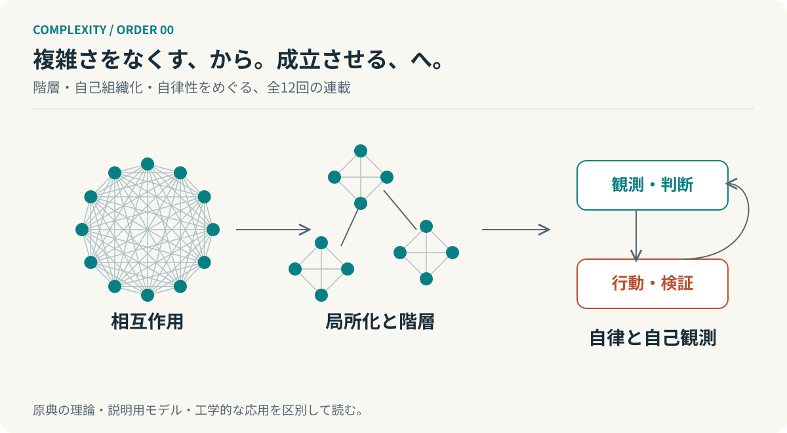
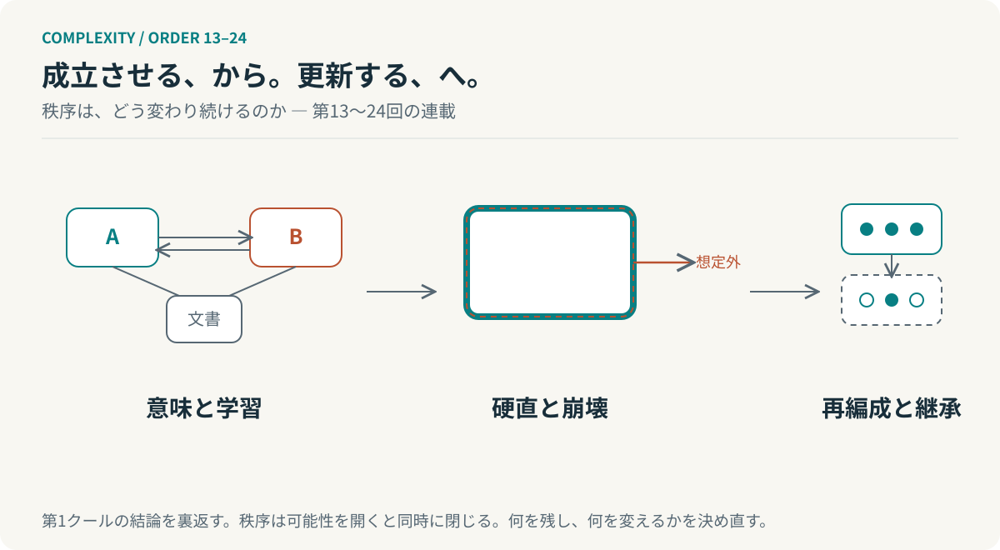

# 複雑さと秩序

## 階層・自己組織化・自律性から、秩序の更新へ



**必要な複雑さを持ち、そのすべてを、すべての参加者へ負わせない。**

第1クール（第1〜12回）は、複雑度のオーダーから出発し、秩序形成、自己維持、環境への適応、観測する主体までをたどる。各回は独立した読み物であり、末尾の問いが次回につながる。第12回は第1クールを振り返るエッセイとなる。第2クール（第13〜24回）は、成立した秩序をどう学習・変化・継承させるかを扱う。

[第1回から読む](chapters/01-complexity-hierarchy.md) ／ [最終回を読む](chapters/12-complexity-and-order.md) ／ [読み方](guides/READING.md)

## 第1クール　階層・自己組織化・自律性（第1〜12回）

| 回 | 文章 | 主題 |
| --- | --- | --- |
| 01 | [複雑さを減らすと、何が増えるのか](chapters/01-complexity-hierarchy.md) | 複雑度のオーダーとサイモンの階層論 |
| 02 | [部品を並べても、全体にはならない](chapters/02-general-system-theory.md) | ベルタランフィの一般システム理論 |
| 03 | [流れているから、かたちが保たれる](chapters/03-dissipative-structures.md) | プリゴジンの散逸構造論 |
| 04 | [一万の動きを、一つの動きとして読む](chapters/04-synergetics.md) | ハーケンのシナジェティクスと隷属原理 |
| 05 | [壊れないのではなく、つくり直している](chapters/05-autopoiesis.md) | オートポイエーシスと自己生産 |
| 06 | [つながるほど生まれやすく、変わりにくくなる](chapters/06-kauffman.md) | 自己触媒集合とNKモデル |
| 07 | [規則に従うものが、規則を書く](chapters/07-strange-loops.md) | ホフスタッターのストレンジループ |
| 08 | [直す前に、何を知るべきか](chapters/08-active-inference.md) | 自由エネルギー原理と能動的推論 |
| 09 | [速くするだけでは、制御できない](chapters/09-requisite-variety.md) | アシュビーの必要多様性の法則 |
| 10 | [中央がすべてを知らなくても、全体は動く](chapters/10-viable-system-model.md) | ビーアの生存可能システムモデル |
| 11 | [測る側も、測られている系の中にいる](chapters/11-second-order-cybernetics.md) | フォン・フェルスターの第二次サイバネティクス |
| 12 | [複雑さは、なぜ秩序を生むのか](chapters/12-complexity-and-order.md) | 階層、自己組織化、そして自律するシステム |

第1回で複雑度とサイモンの階層論を扱う。以降は一回につき一つの主題を中心に接続し、最後に十一の理論的視点を総括する。理論の数を、そのまま科学上の発達段階とみなす構成ではない。

## 第2クール　秩序は、どう変わり続けるのか（第13〜24回）



第1クールの問い「どれほどの複雑さを、私たちは成立させることができるのか」を裏返す。成立した秩序が次の変化を妨げるものになったとき、どうすればよいのか。三部で構成する。

| 部 | 対象回 | 主題 |
| --- | --- | --- |
| Ⅰ　意味と学習 | 第13〜16回 | 理解を確かめ、学び方と見方を変える |
| Ⅱ　秩序の硬直と崩壊 | 第17〜20回 | 成功した仕組みが変われなくなる過程を読む |
| Ⅲ　再編成と継承 | 第21〜24回 | 新しい可能性を試し、集団として引き継ぐ |

| 回 | 文章 | 主題 |
| --- | --- | --- |
| 13 | [同じ言葉を使っていても、同じことを考えてはいない](chapters/13-conversation-theory.md) | パスクの会話理論と、理解を確かめる循環 |
| 14 | [答えを直しているかぎり、解けない問題がある](chapters/14-learning-levels.md) | ベイトソンの学習階層と、学び方を学ぶこと |
| 15 | [情報を減らしたら、判断できるようになった](chapters/15-information-bottleneck.md) | 情報ボトルネックと、何を残すかという設計 |
| 16 | [細かく見れば、原因が分かるとは限らない](chapters/16-causal-emergence.md) | 粗視化と因果創発――説明に適した階層を選ぶ |
| 17 | [選ばれたから、選ばれ続ける](chapters/17-lock-in.md) | ブライアン・アーサーの経路依存性とロックイン |
| 18 | [強くしたところが、弱さになる](chapters/18-robust-yet-fragile.md) | 高度に最適化された頑健性と、想定外への脆さ |
| 19 | [元に戻ることと、生き残ることは違う](chapters/19-resilience.md) | ホリングのレジリエンスと安定性 |
| 20 | [崩れるときにも、残っているものがある](chapters/20-panarchy.md) | パナーキーと、異なる時間スケールの相互作用 |
| 21 | [上手になるほど、試せなくなる](chapters/21-exploration-exploitation.md) | マーチの探索と活用、そして学習の配分 |
| 22 | [みんなのものを、誰が守るのか](chapters/22-commons.md) | オストロムの多中心型ガバナンスとコモンズ |
| 23 | [集まることと、一つになることは違う](chapters/23-major-transitions.md) | 進化の大転換と、新しい単位の成立 |
| 24 | [同じであり続けるために、変わっていく](chapters/24-maintaining-by-changing.md) | 秩序の維持から、秩序の更新へ |

第13回をパスクの会話理論から始め、第24回を第2クール全体を振り返るエッセイとする。第1クールと同じ概念へ戻る場合も、問う対象を変えている。

<!-- SITE-INDEX-END: 以下はリポジトリ利用者向け。HTML閲覧版のトップページには含めない。 -->

## GitHubで読む

このREADMEと各回の `.md` をGitHubの **Preview** で開く。本文中の図は相対リンク先のSVG、数式は `$...$` と `$$...$$` の数式として表示する。[GitHub公式の数式仕様](https://docs.github.com/en/get-started/writing-on-github/working-with-advanced-formatting/writing-mathematical-expressions)を用いるため、Markdown閲覧のためにPagesや専用アプリを起動する必要はない。

外部の画像・フォント・数式画像APIを参照しない。挿絵13点は編集可能な独立SVGである。数学的な式はテキストから組版される。SVGの中に数式画像を隠して代替する構成ではない。

## ブラウザで読む

配布ZIPの `_site/index.html` を開くと、目次付きの閲覧ページを読める。`_site/complete.html`（第1クール）のように、クールごとの全回とSVGを一つにまとめたHTMLも生成され、単独で持ち運べる。数式はネイティブMathMLなので外部CDNやJavaScriptを必要としない。

再生成にはPython 3.11以降とPandoc 3.xを使う。この版はPython 3.13.5・Pandoc 3.1.11.1で検証済みである。CIはPython 3.11を指定するが、GitHub上の実行は未実施である。依存パッケージの追加インストールは不要である。

```sh
python scripts/validate.py
python scripts/build.py
python -m unittest discover -s tests -v
```

GitHub管理対象はMarkdownとSVGなどの原本である。`_site/` は生成物として `.gitignore` で除外する。GitHub Pagesへの配置は手動実行のワークフローで行える。

## 編集・保守・公開

[編集ガイド](guides/EDITING.md)には原本の責務、SVG・数式・出典の編集規則をまとめた。[文体の規則](guides/STYLE.md)には本文の文のリズムと留保の置き方をまとめた。[GitHub登録・Pages公開手順](guides/PUBLISHING.md)には非公開リポジトリ作成用コマンドと公開時の注意を示す。[編集方針と検証範囲](guides/EDITORIAL.md)では、会話からの再編集、理論と応用の区別、出典確認の限界を記載する。

## 原典へ戻る

[参考文献と確認範囲](references/bibliography.md)から、各理論の出典を参照できる。本文の文献注は、その理論の参照先であり、原文の引用ではない。独自の説明用数式、図、開発組織への応用は、本文で区別している。

自然科学の法則、数学的な模型、認知の概念、組織設計の枠組みを一つの普遍法則として扱わない。本連載で示す接続は、次に検証すべき問いをつくるための解釈である。
