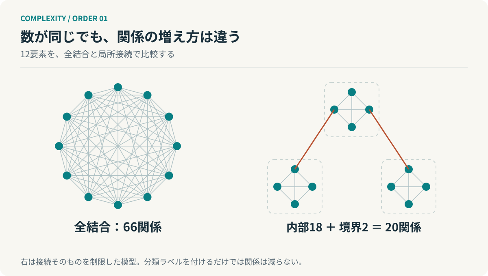
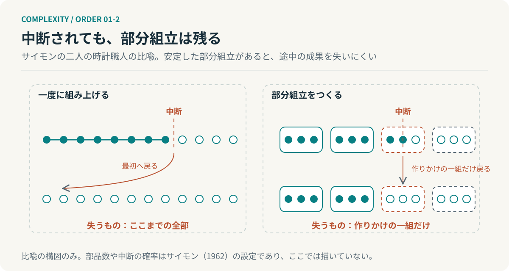

# 第1回　複雑さを減らすと、何が増えるのか

## 複雑度のオーダーとサイモンの階層論

<!-- NAV:TOP -->
[連載目次](../README.md) | [第2回 →](02-general-system-theory.md)
<!-- /NAV -->

打ち合わせの参加者が三人から六人に増えた。人数は二倍である。ところが意見を一巡させるだけならともかく、全員の認識を合わせようとすると時間は二倍では済まない。誰と誰の前提が違い、その違いを直したとき、別の誰の判断が変わるのか。増えたのは仕事そのものというより、仕事と仕事の間である。

「複雑になった」という言葉は便利だが、何が増えたのかを隠してしまう。その隠れた主語を取り戻すところから、この連載を始めたい。

### 数える対象を決める

要素数を $n$ とする。すべての要素の組を一回ずつ、向きを区別せずに調べるなら、関係数は次式になる。

$$
E(n)=\binom{n}{2}=\frac{n(n-1)}{2}.
$$

10要素なら45、100要素なら4,950、1,000要素なら499,500である。二倍にするとおおむね四倍になる。この増え方を $\Theta(n^2)$ と書く。上界だけを示す $O(n^2)$ より、上下から同じ増え方で挟める $\Theta$ の方がこの式には正確である。

ただしこの数は「全員が実際に連絡する回数」ではない。全ペアを対象にしたときの組合せの数である。これをそのまま組織の工数やソフトウェアの不具合数と呼び替えると、数えてもいない処理の分まで、この式に語らせることになる。オーダーを論じるには、入力の規模と数えている処理を先に決める。

さらに $n$ 個の要素がそれぞれ二つの状態を独立に取れるなら、全体の候補状態数は $2^n$ になる。関係数の二次増加と状態数の指数増加は別の問題である。二次元の図に描けるから計算も簡単だという保証はない。

### 棚を増やしても、依存は減らない

*図1：左は66関係。右は4要素の全結合を3組と、組間の2接続で20関係。実線は実際に残す接続を表す。単なる表示上のグループ化ではない。*

ハーバート・サイモンは複雑なシステムに階層がしばしば現れることを論じた。まとまりの内部は密接に相互作用する一方でまとまり同士の相互作用は相対的に弱く、短い時間では部分をある程度独立に扱え、長い時間では部分間の関係も効いてくる。この「準分解可能性」が部分と全体を行き来する足場になる。[^simon]

書類を部署別の棚に分けたとしよう。ところが一枚の書類を直すたびにすべての棚の担当者へ確認が要るなら、仕事はまだ分解されていない。棚の構造と依存の構造は違う。ソフトウェアのディレクトリも組織図も同じである。

ここで一定の大きさ $k$ のモジュールに $n$ 要素を分ける模型を考える。$n$ は $k$ の倍数とし、内部は全結合、モジュール間の接続は一本ずつの木構造に限定する。

$$
E(n,k)=\frac{n(k-1)}{2}+\frac{n}{k}-1.
$$

$k$ を一定に保つなら、この関係数は $\Theta(n)$ で増える。要素を一つも削らず、接続の許し方を変えただけで増加率が変わった。

ただし全結合にあった能力まで無料で保てるわけではない。直接伝えられた情報が中継を必要とし、窓口に負荷が集中するかもしれず、全体を横断する仕事では再び複数の境界を開くことになる。上の式は関係数の模型であって、業務全体の時間計算量を証明する式ではない。

### 小さく見るために、大きくつくる

サイモンの議論には、完成の途中で中断される二人の時計職人の比喩がある。安定した部分組立をつくれる職人は、すべてを一度に組み上げる職人より途中の成果を失いにくい。階層は完成後の理解だけでなく、複雑なものが成立する過程にも関わる。[^simon]

*図1-2：二人の時計職人の比喩。安定した部分組立があると、中断のたびに失う範囲が小さい。階層は完成後の理解だけでなく、成立の過程にも関わる。部品数や中断の確率はサイモン（1962）の設定であり、図には含めない。*

この視点から見ると、モジュールは単なる収納場所ではない。「ここまでは成立した」と扱える単位である。個々の部品を毎回すべて調べ直す代わりに、そのまとまりが満たす条件を確かめる。複雑さを消したのではなく、再検討しなくてよい範囲をつくったのである。

しかしその条件が外れたときに内部へ戻れなければ、抽象化は隠蔽になる。良い境界は、詳細を隠す境界ではない。普段は詳細を求めず、必要なときには根拠へ戻れる境界である。これはサイモンの定理ではなく、本連載が採る工学的な設計原則である。

### 階層の数より、境界の働き

階層が浅いことにも深いことにも、それだけでは優劣がない。探索に使う平衡木なら深さは対数的になるが、組織の承認を一段増やしたからといって判断の時間が短くなるわけではない。構造と探索と認知と調整を一つの「複雑度」にまとめると、この違いを見失う。

仕事を増やしたいなら、要素を増やす前に何が一緒に増えるかを見る。人員を増やすと承認関係も増えるのか、Agentを増やすと相互検証の組合せも増えるのか、それとも各単位が局所的に完結するのか。

**複雑さを減らすためにつくった階層が、より大きな複雑さを成立させる。** これが最初の逆説である。

六人の打ち合わせに戻る。人数はそのままでも、誰と誰が直接すり合わせるかを決めれば線の本数は変わる。机の上に残るのは、人数ではなく線である。

## 参考文献・注記

[^simon]: Herbert A. Simon（1962）. [The Architecture of Complexity](https://www.jstor.org/stable/985254)。Proceedings of the American Philosophical Society, 106(6), 467–482。階層と準分解可能性。

<!-- NAV:BOTTOM -->
---

*次回　第2回「部品を並べても、全体にはならない」。そのまとまりは、要素の一覧と何が違うのか。*

[連載目次](../README.md) | [第2回 →](02-general-system-theory.md)
<!-- /NAV -->
