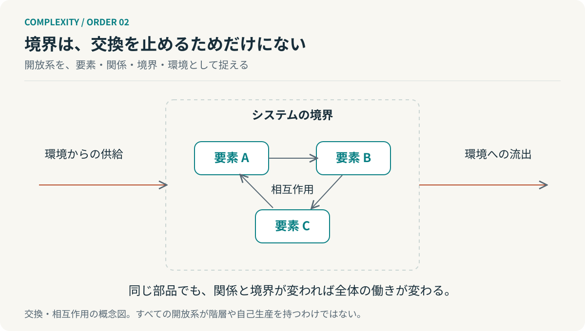
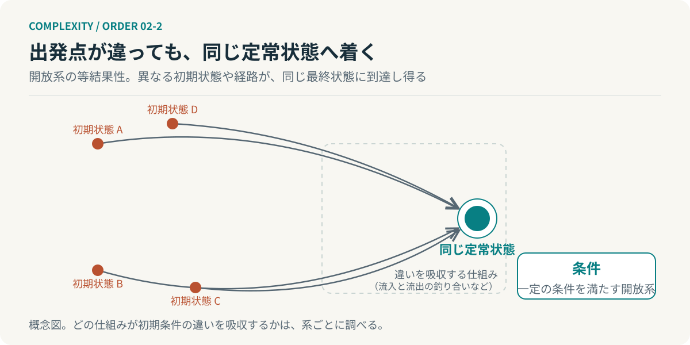

# 第2回　部品を並べても、全体にはならない

## ベルタランフィの一般システム理論

<!-- NAV:TOP -->
[← 第1回](01-complexity-hierarchy.md) | [連載目次](../README.md) | [第3回 →](03-dissipative-structures.md)
<!-- /NAV -->

よく切れる包丁と、十分な食材と、使いやすい調理台。それでも料理はまだできていない。物の集合だけでは足りず、切る順序と加熱のタイミングと食べる人への受け渡しが要る。優れた部分を集めることと全体が働くことの間には、関係の設計がある。

ベルタランフィの一般システム理論はその関係を分析の中心に置く。部分の性質を知るだけでなく、部分が相互作用するときに何が成立するかを問う。[^bertalanffy]

### 全体性は、神秘的な何かではない

「全体は部分の総和ではない」と言うと、部分からは説明できない何かが上から加わるように聞こえる。ここで要るのは神秘ではなく、分析条件の区別である。部品を孤立させて測った性質だけでは結合した状態での振る舞いを取り逃がすから、関係まで含めて調べる。それだけのことである。[^bertalanffy]

たとえば実装者を二人に増やしても、レビュー担当者は一人のままかもしれない。そのとき完成する仕事の量は二人の実装速度の和にならない。人の能力の問題ではなく、流れと制約の問題として調べられる。

本連載ではシステムを次の組で考える。

$$
\mathcal{S}=(X,R,B,\mathcal{E}).
$$

$X$ は構成要素、$R$ は関係、$B$ は分析上の境界、$\mathcal{E}$ は環境である。ベルタランフィの公式な定義の転記ではなく、要素だけの一覧から抜け出すための整理である。

同じ構成要素でも関係が違えば働きが変わる。どこに境界を引くかによって、内部の調整に見えていたことが環境からの入力に見える。システムを語る前に、何を一つとして扱っているかを示しておく。

### 閉じていないから、同じでいられる

*図2：境界は交換を断つ壁ではなく、内部と環境を区別する線である。開放性だけで自己組織化が保証されるわけではない。*

ベルタランフィが重視したのは生物のような開放系である。物質が入れ替わり続けても、一定の巨視的な状態が保たれることがある。定常状態は、何も起きていない状態とは違う。[^bertalanffy]

水が入り、同じ速さで出ていく容器を思い浮かべる。水位は変わらない。だが中の水は同じまま留まっていない。蓄積量 $M$ について、単純な収支は次のように書ける。

$$
\frac{dM}{dt}=J_{\mathrm{in}}-J_{\mathrm{out}}.
$$

$J_{\mathrm{in}}=J_{\mathrm{out}}\ne0$ なら、$dM/dt=0$ でも流れは続く。この式は収支の説明用であり、流入と流出が釣り合うことだけで生命や複雑な秩序を説明できるわけではない。

それでもこの小さな区別は大きい。組織が安定しているとき、変化がないのか、それとも変化を吸収する活動が続いているのか。後者なら、維持に必要な活動を「現状維持だから不要」と削った瞬間に、安定そのものが失われかねない。

### 同じ目的地へ、別の経路から

もう一つの概念が等結果性である。一定の条件を満たす開放系では異なる初期状態や経路から同じ最終状態へ到達し得るが、何でも同じ結果になるという主張ではなく、どの仕組みが初期条件の違いを吸収するかを問う概念である。[^bertalanffy]

*図2-2：等結果性の概念図。一定の条件を満たす開放系では、異なる初期状態や経路から同じ定常状態へ到達し得る。何でも同じ結果になるという図ではなく、どの仕組みが違いを吸収するかを問うための図である。*

ソフトウェア開発へ移すなら、これは手順の一意性と結果の妥当性を分ける着想になる。ある仕様を既存部品の組合せで実装しても、新しい実装で満たしてもよい。ただし同じ受入条件を満たすかは確かめる。一般システム理論からの類推であって、品質保証の法則ではない。

ここで標準化の対象を考え直せる。すべての手順を同じにするのか、それとも互換性が必要な境界と成果の条件をそろえるのか。前者が有効な場面もある。ただし両者を混同すると、工夫の余地まで奪ってしまう。

### 分けるためには、つなぎ方が要る

第1回のサイモンは部分ごとに扱える構造を考えた。ベルタランフィは孤立した部分だけでは全体を捉えられないと強調した。両者は矛盾しない。分解の条件を両側から見ているのである。

部分を無関係にしてしまえば全体は働かない。部分をすべて直接結びつければ、規模を増やすたびに調整が膨らむ。だから内部で完結させる関係と境界に残す関係を区別する。

**分解とは、関係を無視することではない。どの関係を残せば全体が働くかを決めることである。**

ただしここまでの話では、誰かが適切な関係を設計したように見える。包丁も食材も、並べただけでは料理にならなかった。では、誰も献立を書かなくても、料理は始まるのだろうか。

## 参考文献・注記

[^bertalanffy]: Ludwig von Bertalanffy（1968）. [General System Theory: Foundations, Development, Applications](https://www.panarchy.org/vonbertalanffy/systems.1968.html)。George Braziller。リンク先は原著の抜粋。全体性・開放系・等結果性。

<!-- NAV:BOTTOM -->
---

*次回　第3回「流れているから、かたちが保たれる」。外から全体の形を指定しなくても、関係から秩序は生まれるのか。*

[← 第1回](01-complexity-hierarchy.md) | [連載目次](../README.md) | [第3回 →](03-dissipative-structures.md)
<!-- /NAV -->
