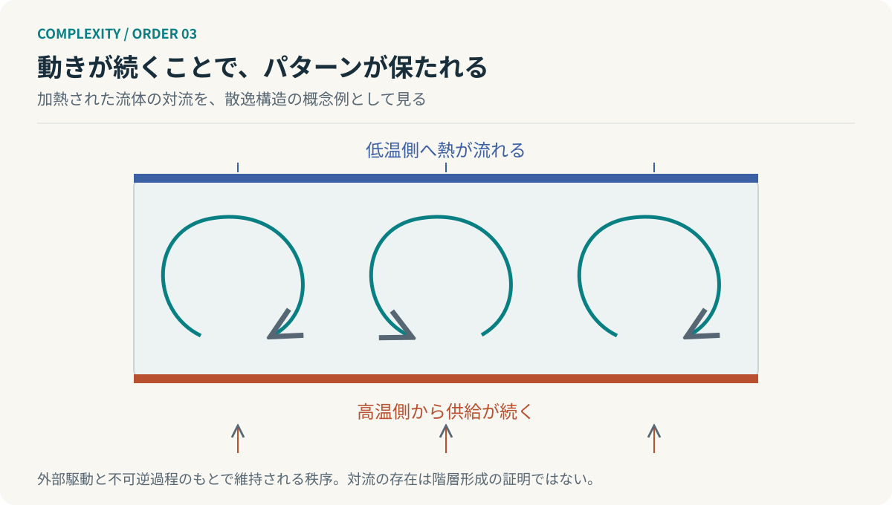

# 第3回　流れているから、かたちが保たれる

## プリゴジンの散逸構造論

<!-- NAV:TOP -->
[← 第2回](02-general-system-theory.md) | [連載目次](../README.md) | [第4回 →](04-synergetics.md)
<!-- /NAV -->

静かな会議室は秩序正しく、議論が飛び交う会議室は混乱している。私たちは、ときどきそんな見方をする。しかし、静かなのは結論が明確だからかもしれないし、誰も問題を持ち出せないからかもしれない。動きが少ないことと、系がうまく働いていることは別である。

この組織の比喩から離れて、まず物理現象を見よう。プリゴジンの散逸構造論が扱うのは、エネルギーや物質の流れのもとで維持される、非平衡の秩序である。組織の活気を熱力学的エントロピーと呼ぶのではなく、物理的な条件を押さえたうえで着想を借りる必要がある。[^prigogine]

### 温度差がつくる運動

下から加熱され、上側が冷やされる流体では、条件によって静止した熱伝導状態が不安定になり、対流が生じる。流れの形を外から一本ずつ描いたわけではない。温度差、浮力、粘性、境界条件が組み合わさって、巨視的なパターンが成立する。[^prigogine]

*図3：対流ロールの概念図。特定実験の測定結果ではない。一定の加熱・冷却と境界条件のもとで流れが維持される。*

この秩序は、流れが止まっても同じように残る置物ではない。駆動条件を失えば、同じパターンを保てなくなる。形を維持するために変化を止めるのではなく、変化が続くことで形が維持される。[^prigogine]

### 第二法則は破られていない

秩序が現れると、エントロピー増大則の例外のように見えるかもしれない。しかし、開放系では環境との交換を含めて収支を考える。

$$
\frac{dS}{dt}=\dot S_e+\dot S_i,\qquad \dot S_i\ge0.
$$

$\dot S_e$ は外部との交換によるエントロピー変化率、$\dot S_i$ は内部の不可逆過程による生成率である。定常状態では、内部で生成した分を外へ正味で排出し、$dS/dt=0$ になり得る。秩序の維持とエントロピー生成は両立する。[^prigogine]

ここで「複雑度」「情報の不確実性」「熱力学的エントロピー」を同じ量として足してはいけない。対象、単位、定義が違う。似た語感は、等式の根拠にはならない。

### 揺らぎが残る条件

秩序形成の直感を、小さな分岐モデルで確かめよう。

$$
\dot u=\mu u-u^3.
$$

これは散逸構造全般の法則ではなく、超臨界ピッチフォーク分岐の説明用の正規形である。$\mu<0$ では $u=0$ が安定し、$\mu>0$ では $u=0$ が不安定になって、$u=\pm\sqrt{\mu}$ が安定する。

小さなずれが戻される領域と、増幅される領域がある。まったく同じ大きさの揺らぎでも、系の安定性によって意味が変わる。なお、完全に $u=0$ から始めれば、決定論的な式の上ではそのまま留まる。どちらの枝へ移るかを語るには、初期のずれや雑音を別に考える必要がある。

この区別を消して「混乱を増やせば新しい秩序が生まれる」と言うのは危険である。負荷を増やせば故障するだけの系もある。秩序形成には、駆動、相互作用、不安定性、安定化する機構の具体的な条件が要る。

### カオスは、階層の別名ではない

数学的なカオスは、初期条件への鋭敏な依存などで特徴づけられる動的現象である。日常語の「入り乱れた状態」と一致しない。また、対流パターンができたという事実だけでは、そのパターンの内側に別の生存可能な単位が入れ子で存在するとは言えない。

秩序形成、カオス、階層形成は別々に検証すべきである。前二回との接続は、局所的なまとまりが動的に現れ、そのまとまりを上位の単位として扱える場合がある、という条件付きの解釈になる。

### 安定性を守るのか、安定性の条件を変えるのか

開発組織に戻ろう。生成能力を高めた結果、レビュー待ちが増えたとする。流入件数を $A_t$、完了件数を $D_t$、未完了件数を $B_t$ とすれば、単純な収支は次になる。

$$
B_{t+1}=B_t+A_t-D_t.
$$

この式は熱力学ではない。ただ、既存の構造がどの流入量で維持できるかを調べるための記述である。待ちが増えたとき、担当者を急がせるだけでなく、局所承認、契約検証、作業分割の条件を変更する選択肢が生まれる。

散逸構造論から借りるべきなのは、「混乱が良い」という標語ではない。**安定した状態だけでなく、その安定を成立させる流れと条件を観測する**という視点である。

次回は、できあがった集団パターンをどう記述できるかを考える。多数の要素をすべて追跡しなくても、少数の変数で説明できるのだろうか。

## 参考文献・注記

[^prigogine]: Ilya Prigogine（1977）. [Time, Structure and Fluctuations](https://www.nobelprize.org/uploads/2018/06/prigogine-lecture.pdf)。ノーベル講演。非平衡・散逸・不安定性を扱う。

<!-- NAV:BOTTOM -->
---

[← 第2回](02-general-system-theory.md) | [連載目次](../README.md) | [第4回 →](04-synergetics.md)
<!-- /NAV -->
