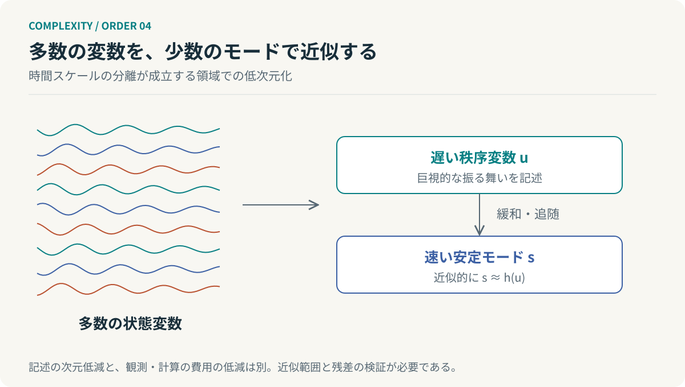
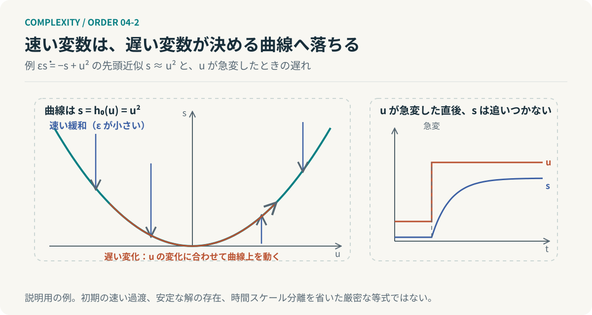

# 第4回　一万の動きを、一つの動きとして読む

## ハーケンのシナジェティクスと隷属原理

<!-- NAV:TOP -->
[← 第3回](03-dissipative-structures.md) | [連載目次](../README.md) | [第5回 →](05-autopoiesis.md)
<!-- /NAV -->

集団の動きを一人ずつ追うと、目が足りない。ところが全員が同じ周期で動き始めると、個別の動きよりも集団のリズムの方が目に入る。要素は一つも減っていない。それでも説明に必要な情報は変わった。

多数の要素の協同から生じる巨視的な秩序を、ハーケンのシナジェティクスは扱う。核心の一つが、少数の秩序変数と速く緩和する多数のモードを区別する隷属原理である。[^haken]

### 部屋を分けるのではなく、動きをまとめる

サイモンの階層論は、相互作用が比較的局所化された部分に注目した。ハーケンの視点は少し違う。各要素を別々の部屋に入れなくても、集団のダイナミクスを低次元で記述できる場合がある。

*図4：秩序変数は任意の平均値ではない。速いモードの安定性と時間スケール分離が成り立つ領域で、低次元近似を考える。*

ここで「一つの変数が全員に命令する」と捉えると誤る。秩序変数は集団の相互作用から成立する巨視的な記述であって、上位の管理者を一人追加したという話ではない。[^haken]

### 速い変数を、ゆっくりした変数に合わせる

基本形を遅い変数 $u$ と速い変数 $s$ に分けて書く。

$$
\begin{aligned}
\dot u&=F(u,s),\\
\varepsilon\dot s&=G(u,s),\qquad 0<\varepsilon\ll1.
\end{aligned}
$$

$u$ が大きく変化するより先に、$s$ が安定した状態へ近づくなら、先頭近似として $G(u,s)=0$ を解き、$s\approx h_0(u)$ と置ける。

$$
\dot u\approx F\bigl(u,h_0(u)\bigr).
$$

これで速い変数を毎回独立した状態として解かずに済む。この断熱消去は隷属原理の考え方へ入る簡略な入口である。ただし初期の速い過渡や安定な解の存在や時間スケール分離を無視した厳密な等式ではない。[^haken]

たとえば $\varepsilon\dot s=-s+u^2$ なら、先頭近似は $s\approx u^2$ になる。しかし $u$ が急変している瞬間には $s$ はただちに追いつかない。近似には適用領域と誤差がある。低次元化は詳細が消えることではない。

*図4-2：断熱消去の概念図。例 $\varepsilon\dot s=-s+u^2$ では $s$ が曲線 $s\approx u^2$ へ速く近づき、その後は $u$ の遅い変化に従う。右は $u$ が急変した直後に $s$ が追いつかない遅れ。説明用の例であり、時間スケール分離が成り立つ領域での近似である。*

### 平均値をつくるだけでは足りない

プロジェクトの健康状態を進捗率の一つの数字にまとめたくなる。ところが同じ80%でも、残りが単純な作業なのか未解決の難所なのかで未来は違う。一つの数字をつくれたことは、一つの数字でダイナミクスを説明できることの証明にならない。何を省いて一つになったのか。

同様に主成分分析で分散の大きい方向が得られても、それだけで遅い秩序変数を見つけたことにはならない。観測の要約と予測モデルの次元削減と隷属原理の成立は、別々の話である。

実務で試すなら、少数の状態変数を使ったモデルが未知の期間の観測をどれだけ説明できるかを確かめ、そのうえで負荷が変わった期間に近似が崩れていないかを調べる。理論を参考にした実験設計であって、指標に名前を付けるだけでは済まない。

### 次元が減っても、計算量が消えるわけではない

元の変数数を $n$、縮約後を $k$ とすれば、$k\ll n$ という関係は魅力的である。しかし毎回すべてのセンサーを読んでから $k$ 個の値を算出するなら、入力を読むコストは残る。

$$
T_{\mathrm{total}}(n,k)=T_{\mathrm{observe}}(n)+T_{\mathrm{reduce}}(n,k)+T_{\mathrm{predict}}(k).
$$

これは本連載の工学的な費用分解である。最後の予測を軽くできても、観測と縮約を含めた全体の増加オーダーまで変わるとは限らない。低次元で長時間の予測を繰り返す場合と、一回だけ全件を厳密に検証する場合では利得も違う。

### 自由度を手放して、機能を得る

個別要素の独立性が減ると、可能な振る舞いは制約される。その一方で、まとまった運動として扱える機能が現れることがある。制約は失うものだけを生まない。協調の条件にもなる。

ただし同期が強いほどよいわけでもない。全員が同じ誤りを共有すれば、個別の検証能力まで失う。何をそろえ、何を独立に保つかを分ける。

**複雑さの縮約とは、要素の削除だけではない。独立に追跡する必要のある自由度を減らすことでもある。**

ここまでで、秩序が生まれ、その動きをまとめて記述できる条件を考えた。冒頭の集団に戻れば、全員が同じ周期で動いている間、私たちは一つのリズムを見ている。だが周期を保っているのは誰なのか。乱れた拍子を、集団は自分で立て直すのか。

## 参考文献・注記

[^haken]: Hermann Haken（1996）. [Slaving principle revisited](https://doi.org/10.1016/0167-2789(96)00080-2)。Physica D, 97, 95–103。秩序変数と隷属原理。

<!-- NAV:BOTTOM -->
---

*次回　第5回「壊れないのではなく、つくり直している」。まとまりが一時的に現れることと、そのまとまりが自分自身をつくり続けることは違う。*

[← 第3回](03-dissipative-structures.md) | [連載目次](../README.md) | [第5回 →](05-autopoiesis.md)
<!-- /NAV -->
