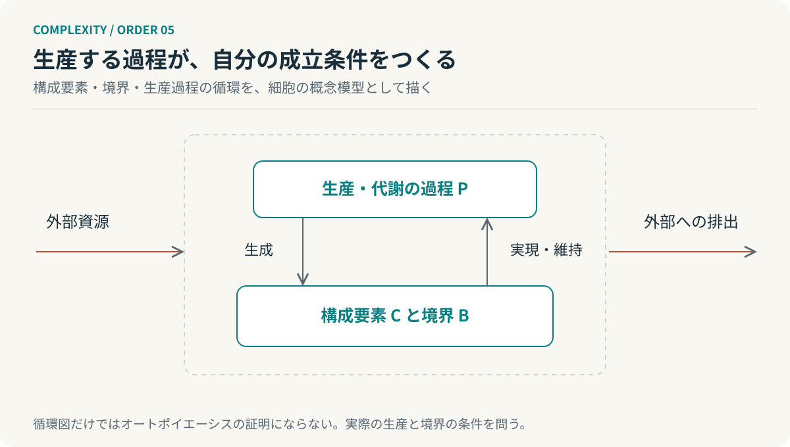

# 第5回　壊れないのではなく、つくり直している

## オートポイエーシスと自己生産

<!-- NAV:TOP -->
[← 第4回](04-synergetics.md) | [連載目次](../README.md) | [第6回 →](06-kauffman.md)
<!-- /NAV -->

長く動いている仕組みを見ると、私たちは頑丈なのだと思う。しかし、頑丈であることと、傷んだ箇所を更新し続けることは違う。同じ状態が続いて見える裏で、構成要素は入れ替わっているかもしれない。

オートポイエーシスは、その「つくり続ける」という側面から生命の組織を捉える。マトゥラーナ、ヴァレラ、ウリベの定式化で中心となるのは、構成要素を生産する過程が、その構成要素によって再び成立するネットワークである。[^autopoiesis]

### 製品ではなく、生産する自分が生まれる

普通の工場では、機械が製品を生産する。製品は工場の外へ出ていく。生産がうまく続いても、その工場が自らの機械や生産組織を生み出しているとは限らない。

細胞を概念的に見ると、代謝過程が構成物質を生み、それらが代謝の仕組みや境界を成立させる。境界によって条件が維持され、その内部で生産過程が続く。生産の結果が、次の生産を可能にする構成へ戻ってくる。[^autopoiesis]

*図5：自己生産の概念図。実在の細胞の反応経路ではない。矢印の循環だけではオートポイエーシスの十分条件にならない。*

本連載の記号で、生産過程を $P$、構成要素を $C$、境界を $B$ とすれば、直感は次のように表せる。

$$
P\longrightarrow(C,B)\longrightarrow P.
$$

ただし、循環グラフが描けたら生命ができた、とはならない。どの生産過程がどの構成要素によって実現され、どの空間で一つの単位が成立するかを具体化する必要がある。この式は説明用の記号であり、原理の証明ではない。

### 開いているのに、閉じている

ここでは「組織的閉鎖」という言葉が誤解を招きやすい。外部と無関係になり、何も受け入れないという意味ではない。構成を成立させる過程が、互いを成立させるネットワークとして閉じているという意味である。[^autopoiesis]

物質とエネルギーについては開いている。外部の資源に依存している。しかし、外から部品を完成品として取り替えてもらうだけで存続している仕組みとは、組織の成立の仕方が違う。

この区別は、自律性を「外部を一切必要としないこと」と取り違えないために役立つ。依存をなくすのではなく、依存しながら自分の組織を成立させる。ここに一般システム理論の開放系との接点がある。

### 流れの維持と、構成の生産

プリゴジンの散逸構造は、非平衡で秩序が維持されることを扱った。対流が持続していても、それだけで容器や加熱装置が対流自身によって生産されているわけではない。散逸構造と自己生産は同義ではない。

ハーケンの縮約とも違う。少数の変数で記述できるからといって、その系が自らの構成を生産するとは限らない。逆に、自己生産する系を、いつでも少数の変数に縮約できる保証もない。

この連載の理論は、一段ずつ上がれば次の能力が必ず得られる階段ではない。それぞれが異なる問いを担当している。持続するのか、低次元で記述できるのか、自らを生産するのか。似た現象を別々の条件で検査するのである。

### 自動復旧は、何を維持しているのか

ソフトウェアへ移すと、サーバーの再起動、依存の更新、壊れた環境の再構築は、自己維持に着想を得た工学的な機構になる。しかし、これらをそのままオートポイエーシスと認定するのは飛躍である。計算基盤、電力、保守の責任、更新の基準を誰が供給しているかという境界の問題が残る。

そのうえで、設計の問いとしては有効である。Agentが一回のタスクを成功させるのか。失敗から回復できるのか。それとも、そのタスクを明日も実行できる条件を維持するのか。この三つを分けて考えられる。

たとえば、テストAgentがテストケースだけを出力しても、実行環境の崩壊には対応できない。環境を修復できても、修復によって品質ゲートが弱くなっていれば目的を失う。維持する対象を「動作すること」だけに置くか、「受入条件を保って動作すること」に置くかで、構成は変わる。

### 自律性には、境界が要る

すべての変更を内部で許せば自律的、というわけではない。自分を評価する基準まで都合よく変更できれば、存続の名の下に本来の役割を失うこともある。実行規則、評価規則、変更権限は別に管理するべきである。これは本連載の工学的な提案であり、生物学的な定義から直接導かれる法則ではない。

**自己維持を設計するとは、何を変えてよく、何を変えては同じシステムでなくなるかを決めることでもある。**

ここで、さらに手前の問いが生じる。互いを生産するネットワークは、どのような条件で成立し得るのか。次回はカウフマンの自己触媒集合とNKモデルを使い、結合が成立を助ける面と、変化を妨げる面を対比する。

## 参考文献・注記

[^autopoiesis]: Francisco G. Varela, Humberto R. Maturana, Ricardo Uribe（1974）. [Autopoiesis: The organization of living systems, its characterization and a model](https://pubmed.ncbi.nlm.nih.gov/4407425/)。BioSystems, 5(4), 187–196。DOI: 10.1016/0303-2647(74)90031-8。

<!-- NAV:BOTTOM -->
---

[← 第4回](04-synergetics.md) | [連載目次](../README.md) | [第6回 →](06-kauffman.md)
<!-- /NAV -->
