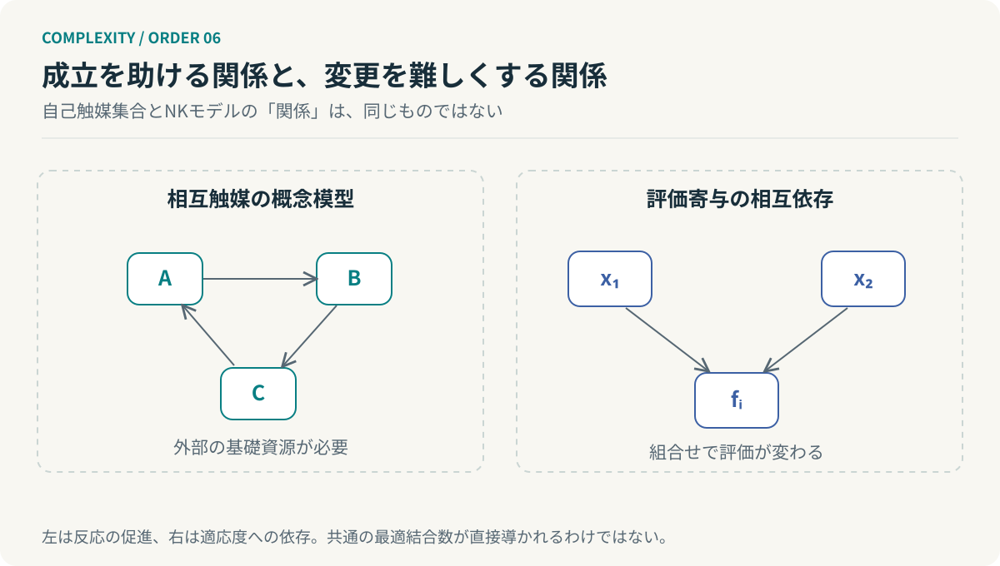

# 第6回　つながるほど生まれやすく、変わりにくくなる

## 自己触媒集合とNKモデル

<!-- NAV:TOP -->
[← 第5回](05-autopoiesis.md) | [連載目次](../README.md) | [第7回 →](07-strange-loops.md)
<!-- /NAV -->

一人では成立しない仕事が、仲間がいると回り始める。誰かの出力が別の誰かの入力になり、その結果が最初の仕事を助ける。ところが、全員が互いの仕事を前提にし始めると、今度は一箇所を変えるだけで全体が揺れる。

つながりが足りないと成立しない。つながりが広がりすぎると変えにくい。この二面性を考える足場が、カウフマンの自己触媒集合とNKモデルである。ただし、二つのモデルにおける「関係」は同じ種類ではない。共通の最適な結合数を導く一つの法則として扱ってはいけない。[^kauffman] [^nk]

### 自分ではなく、互いの生成を助ける

自己触媒集合では、ある分子が別の分子の生成反応を触媒し、その生成物がさらに別の反応を助ける。個々の分子が自分自身の複製能力を持っていなくても、集合として互いの生産を支える構造が成立し得る。外部から供給される基礎資源は必要である。[^kauffman]

後にホルダイクとスティールらが整備したRAF理論では、化学反応系を分子集合 $X$、反応集合 $R$、触媒関係 $C$、資源集合 $F$ の組で表す。

$$
\mathcal Q=(X,R,C,F).
$$

非空の反応部分集合 $R'$ がRAFであるには、必要な反応物を $F$ から $R'$ の反応で生成できることと、各反応に対して資源または生成可能な分子の中に触媒があることが必要になる。[^raf]

*図6：左は生成を助ける触媒関係、右は評価への相互依存であり、同じ辺の密度を比較した実験ではない。*

ここには注意がある。RAFが見つかったことは、現実に十分な速度で反応が持続する証明ではない。初期に必要な触媒、低い反応速度、物質の流出、濃度の維持などは別に検討する。反応物の生成可能性を調べる際に触媒の即時供給まで要求しない形式化では、立ち上がりに未触媒反応や種が必要な場合もある。

構造的な可能性と、動的な実現可能性を分ける。この区別は、依存関係が解決したからWorkflowが実運用で安定する、と早合点しないためにも重要である。

### 変更の評価が、隣の状態で変わる

NKモデルでは、$N$ 個の二値要素を持つ構成 $x$ を考える。各要素の適応度寄与は、自分とほかの $K$ 要素の状態に依存する。

$$
F(x)=\frac1N\sum_{i=1}^{N}f_i(x_i,x_{i_1},\ldots,x_{i_K}),
\qquad x_i\in\{0,1\}.
$$

構成の候補数は $2^N$ であり、$K$ によらない。一方、一つの寄与を表形式で与えるなら、その入力組合せは $2^{K+1}$ 通りになる。標準的なランダムNKモデルでは、依存が増えると局所的な変更の影響が複雑になり、多数の局所最適を持つ地形が現れやすくなる。[^nk]

$K=0$ なら寄与は独立であり、各要素の良い選択を別々に求められる。依存があると、一つの選択を改善したつもりが、ほかの寄与を悪化させる場合がある。しかし、$K$ だけから実世界の探索時間のオーダーを断定することもできない。依存の配置、寄与関数、探索法によって問題は変わる。

### 全体の候補は残っていても、全探索は不要になる

$N=mk$ 個の要素が、完全に独立した $m$ 個のモジュールへ分けられるとする。各モジュールに $k$ 個の二値要素があり、全体評価が独立な評価の和なら、次が成立する。

$$
\max_{x_1,\ldots,x_m}\sum_{j=1}^{m}F_j(x_j)
=\sum_{j=1}^{m}\max_{x_j}F_j(x_j).
$$

全体の候補数は依然として $2^N$ である。しかし、モジュール内部を列挙する候補評価回数は $m2^k$ にできる。たとえば $N=24$、$k=4$ なら、全構成は16,777,216通りだが、独立な6モジュールの各16通り、合計96回の局所評価で足りる。評価一回の費用は別に数える。

これは完全分離できる模型の計算である。境界に横断的な制約があれば、その96という数だけでは全体を解けない。モジュール化がもたらす価値と、成立条件を同時に見せる例である。

### 関係を減らすのではなく、置く場所を選ぶ

自己触媒集合が問うのは、相互に生産を支える構造が成立するかである。NKモデルが問うのは、評価が相互依存するとき、局所変更でどこへ進めるかである。生成を助ける関係と評価を結びつける関係を同じものにしないまま、設計上の示唆を引き出せる。

**必要な内部結合は保持し、変更の影響が無制限に外へ伝わる結合を抑える。**

これはサイモンの準分解可能性への帰還でもある。独立した部品を増やすだけでは、必要な協調を失う。逆に、何でも共有すれば、局所的な改善が難しくなる。境界の価値は、線の本数より、何の変更を内側で吸収できるかにある。

次回は、別の種類のつながりを扱う。生産や評価の依存ではなく、システムが自分自身を記述する関係である。規則に従うものが、その規則を対象にすると、階層はどう変わるのだろうか。

## 参考文献・注記

[^kauffman]: Stuart A. Kauffman（1986）. [Autocatalytic sets of proteins](https://pubmed.ncbi.nlm.nih.gov/3713221/)。自己触媒集合の基礎文献。

[^raf]: Wim Hordijk, Mike Steel（2004）. [Detecting autocatalytic, self-sustaining sets in chemical reaction systems](https://doi.org/10.1016/j.jtbi.2004.02.020)。Journal of Theoretical Biology, 227(4), 451–461。RAFの形式化と検出。

[^nk]: Stuart A. Kauffman, Edward D. Weinberger（1989）. [The NK model of rugged fitness landscapes and its application to maturation of the immune response](https://pubmed.ncbi.nlm.nih.gov/2632988/)。Journal of Theoretical Biology, 141(2), 211–245。

<!-- NAV:BOTTOM -->
---

[← 第5回](05-autopoiesis.md) | [連載目次](../README.md) | [第7回 →](07-strange-loops.md)
<!-- /NAV -->
