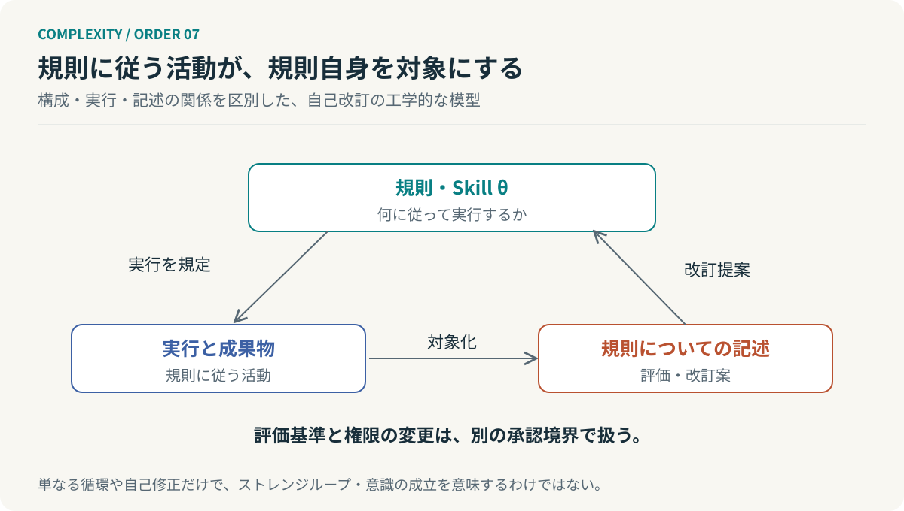

# 第7回　規則に従うものが、規則を書く

## ホフスタッターのストレンジループ

<!-- NAV:TOP -->
[← 第6回](06-kauffman.md) | [連載目次](../README.md) | [第8回 →](08-active-inference.md)
<!-- /NAV -->

手順書に従って仕事をする。その結果を記録し、うまくいかなかった箇所を直す。ここまではよくある改善である。では、その仕事の一つが「この手順書を改訂すること」だったらどうだろう。規則に従った活動が、次の活動を支配する規則を変えている。

この構造を見ただけで、意識が生まれたと結論づけることはできない。しかし、規則と対象の階層を固定したままでは捉えにくい循環がある。ホフスタッターのストレンジループは、抽象階層をたどると出発点へ戻るような自己参照の構造を考える枠組みである。[^hofstadter]

### 回っていれば、同じループなのか

温度が下がれば暖房を入れる。暖まれば止める。これはフィードバックである。関数が自分自身を呼ぶなら再帰である。文章がその文章自身に言及すれば自己参照である。どれも循環に関係するが、同義ではない。

ストレンジループで焦点となるのは、異なる抽象レベルを行き来するなかで自己参照が成立し、上位と下位の区別が交錯することである。単に無限に繰り返すことではない。ホフスタッターはこの概念を自己や意識の理解へも展開するが、本連載では、それを確立した意識の判定法として採用しない。[^hofstadter]

*図7：自己改訂を説明する工学的な類比。上向きの関係だけでなく、「規則を記述・改訂する」という別種の辺が加わる。*

### どの関係の階層なのか

グラフの各頂点にレベル $L(v)$ を与え、すべての辺でレベルが厳密に上がるなら、有向閉路はつくれない。

$$
(u,v)\in E\ \Longrightarrow\ L(v)>L(u).
$$

閉路に沿って不等式をつなぐと、最後には $L(v)>L(v)$ という矛盾になるからである。これは純粋にグラフの性質である。

しかし、現実の説明では異なる辺を混ぜやすい。「構成する」「命令する」「記述する」「評価する」は違う関係である。構成の関係が木構造でも、評価の関係は循環してよい。別の関係を加えたグラフに閉路ができたからといって、構成上の階層が数学的に破綻したわけではない。

この区別は、システムをEntityと関係としてモデル化する際にも重要である。単に `related_to` という辺ですべてを結ぶと、何が循環しているのかが分からなくなる。階層を議論するなら、その階層を成立させる関係型を明示すべきである。

### 自分をつくることと、自分を記述すること

オートポイエーシスでは、生産過程と構成要素が互いを成立させる。そこに自分の説明書が必ずあるとは限らない。自己生産と自己記述は別である。

同じく、ハーケンの隷属原理で巨視的変数と微視的状態を関連づけられても、それが系自身についての意味的な記述を生むとは限らない。動的な縮約と、抽象階層をまたぐ自己参照は別の軸になる。

ここまでの理論を一列に並べたくなる気持ちは理解できる。しかし、自己組織化したら自己生産し、自己生産したら自己意識を持つ、という階段をこの連載は主張しない。隣接しているように見える概念の間に、追加の条件がある。

### 自己修正のどこを閉じるか

AIエージェントの例として、実行規則を $\theta_t$、成果物を $y_t$、評価基準を $\phi$ としよう。

$$
\begin{aligned}
y_t&=A_{\theta_t}(x_t),\\
\theta_{t+1}&=U\bigl(\theta_t,\operatorname{Eval}_{\phi}(y_t)\bigr).
\end{aligned}
$$

これは本連載の自己改訂モデルである。Agentは結果を使って規則を更新する。一方、評価基準 $\phi$ は、この更新から独立に管理している。

もし同じ実行主体が $\phi$ も自由に書き換えれば、失敗を改善する代わりに、失敗の定義を変える経路ができる。スコアだけを見れば改善に見えても、仕事の質は改善していないかもしれない。問題は自己参照そのものではなく、更新してよい対象と、検証を支える基準の境界である。

成果物の修正、実行規則の変更、評価基準の変更を別の履歴にする。基準の変更には、その根拠と承認主体を残す。これがこの比喩から得られる、具体的な設計案である。

### 反省を一段増やすことの限界

「評価器を評価するAgent」を置けば解決する、と考えることもできる。しかし、そのAgentの評価を誰が確かめるのか。階層を際限なく積み増しても、基準の正当性は自動的には生まれない。

必要なのは、すべてを内側だけで正当化する循環ではない。外部の受入条件、観測できる実行結果、独立した証拠に接続し、どこで人間が責任を持つかを定めることである。

**自分を対象として扱えることと、自分だけで正しさを保証できることは違う。**

では、その外部の状態を、システムはどう知るのか。次回はフリストンの自由エネルギー原理と能動的推論を通じ、観測、内部モデル、行動をつなぐ。

## 参考文献・注記

[^hofstadter]: Douglas R. Hofstadter（2007）. [I Am a Strange Loop](https://www.hachettebookgroup.com/titles/douglas-r-hofstadter/i-am-a-strange-loop/9780465030798/)。Basic Books。概念枠組みとして参照。前著 Gödel, Escher, Bach（1979）も背景にある。

<!-- NAV:BOTTOM -->
---

[← 第6回](06-kauffman.md) | [連載目次](../README.md) | [第8回 →](08-active-inference.md)
<!-- /NAV -->
