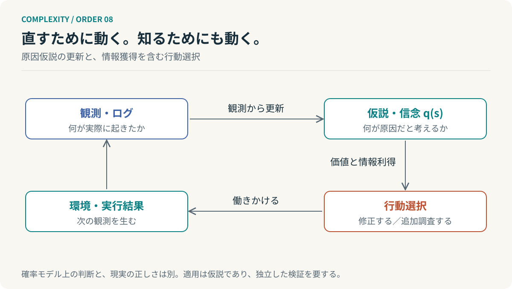

# 第8回　直す前に、何を知るべきか

## 自由エネルギー原理と能動的推論

<!-- NAV:TOP -->
[← 第7回](07-strange-loops.md) | [連載目次](../README.md) | [第9回 →](09-requisite-variety.md)
<!-- /NAV -->

テストが失敗した。直ちにコードを書き換えるべきだろうか。実装の不具合だけでなく、データの誤りや環境の問題や期待値の誤認もあり得る。間違った仮説に基づく修正は新しい問題をつくる。

何かを実行する前に、何を知らないのかを考える。そしてその不確実性を減らす観測を選ぶ。この行動の捉え方は、フリストンの自由エネルギー原理と能動的推論に接続できる。[^friston] [^active]

### 世界ではなく、世界についての信念を持つ

観測を $o$、直接は見えない状態を $s$ とする。内部にあるのは状態そのものではなく、観測を説明する生成モデル $p(o,s)$ と、状態についての信念である。近似事後分布を $q(s)$ とすると、変分自由エネルギーは次で定義できる。

$$
F[q]=\mathbb E_{q(s)}[\ln q(s)-\ln p(o,s)].
$$

同じ量を変形すると、モデル内の事後分布との距離と、観測の驚きに分けられる。

$$
F[q]=D_{\mathrm{KL}}\bigl(q(s)\Vert p(s\mid o)\bigr)-\ln p(o)
\ge-\ln p(o).
$$

固定したモデルと観測について $F$ を小さくすることは、近似信念をそのモデルの事後分布に近づけることである。ここでの自由エネルギーは情報理論的な量であり、ギブズ自由エネルギーや開発工数そのものではない。[^friston]

また $p(s\mid o)$ は「世界の真実」ではない。そのモデル内での事後分布である。候補から本当の原因を落としていれば、内部でどれほど整合的に推論しても誤った結論に到達する。

### 認識を変えるか、次の観測を変えるか

*図8：行動には修正だけでなく、ログ取得などの情報獲得も含まれる。これは実装方針を示す概念図である。*

観測に合わせて信念を更新することと、環境へ働きかけて次の観測を変えることは別である。能動的推論はこの両方を扱う。まだ観測していない未来を含むため、行動系列である方策 $\pi$ の評価には予測分布を使う。[^active]

一つの整合した離散モデルを考え、$q(o\mid s,\pi)=p(o\mid s,\pi)$ とする。望ましい結果の分布を $p^*(o)$ と置くと、期待自由エネルギーの代表的な表現は次になる。

$$
G(\pi)=D_{\mathrm{KL}}\bigl(q(o\mid\pi)\Vert p^*(o)\bigr)
+\mathbb E_{q(s\mid\pi)}H[p(o\mid s,\pi)].
$$

この場合、同じ式を期待情報利得によって書き直せる。

$$
G(\pi)=-\mathbb E_{q(o\mid\pi)}\ln p^*(o)-I_q(s;o\mid\pi).
$$

小さい $G$ を選ぶなら、望ましい結果を得ることに加え、隠れた状態について情報を得ることにも価値がある。式の適用には分布とモデルの整合が必要であり、すべての論文のEFE表現を無条件に同一視しているわけではない。[^active]

### 最も疑わしい原因へ、すぐ手を付けない

仮に実装不具合50%、データ不備30%、仕様誤認20%という信念を持っているとしよう。数字は説明用である。実装が最も疑わしいからといって、直ちに書き換えるのが最善とは限らない。

ログを一つ読むだけで実装とデータの仮説を大きく分けられるなら、その調査に価値がある。仕様の確認が短時間で済み、誤修正の被害が大きいなら、先に期待値の根拠を確かめる方がよい場合もある。

実際の順位は事前確率だけでは決まらない。調査結果の予測と費用と遅延と修正の可逆性まで定義して初めて、「情報を取りに行く」は実装できる判断規則に近づく。

### 階層的な推論は、集計表ではない

個々のテスト結果から機能の状態を推定し、機能の状態からリリース可能性を考える。上位の仮説は下位の観測の解釈に使われ、下位の証拠は上位の信念を更新する。単に数字を上へ足していく集計とは違う。[^friston]

ただしサイモンの構造的階層とハーケンの動的な縮約と確率モデルの階層は、同じものではない。フォルダを階層化しただけで推論が安くなる保証もない。

$N$ 個の二値の隠れ状態の同時分布は、一般に $2^N$ 個の状態を持つ。平均場近似 $q(s)=\prod_iq_i(s_i)$ なら保持するパラメータを減らせるが、依存関係を近似する代償がある。最適化の収束や一回の更新費用も別の問題である。

### 原理を採用する前に、効果を測る

自由エネルギー原理は広い範囲へ適用される理論枠組みだが、あらゆる自律系が実際に同じアルゴリズムを実行しているとまでは、確立した事実として扱わない。開発Agentへの応用はここでは設計仮説である。

まず「失敗したら修正する」方式と「仮説を持ち、追加観測を選ぶ」方式を比較できる。原因特定の正確さと不要な修正と解決時間と利用費用を測る。理論の語彙で名付けたかではなく、実際に判断が改善したかを確かめる。

**自律性の価値は、行動を増やすことだけにない。行動する前に、何を確かめるべきかを選べることにもある。**

失敗したテストに戻る。赤い結果はまだ画面に出たままで、コードには一行も触れていない。手を動かす前に、何を読むか。その一つの選択に、直すことと知ることの違いが現れる。

## 参考文献・注記

[^friston]: Karl Friston（2010）. [The free-energy principle: a unified brain theory?](https://www.nature.com/articles/nrn2787)。Nature Reviews Neuroscience, 11, 127–138。DOI: 10.1038/nrn2787。

[^active]: Ryan Smith, Karl J. Friston, Christopher J. Whyte（2022）. [A step-by-step tutorial on active inference and its application to empirical data](https://pmc.ncbi.nlm.nih.gov/articles/PMC8956124/)。Journal of Mathematical Psychology, 107, 102632。方策評価・期待情報利得の補足。

<!-- NAV:BOTTOM -->
---

*次回　第9回「速くするだけでは、制御できない」。環境にあるあらゆる状態を、一つの主体が識別できるのか。*

[← 第7回](07-strange-loops.md) | [連載目次](../README.md) | [第9回 →](09-requisite-variety.md)
<!-- /NAV -->
