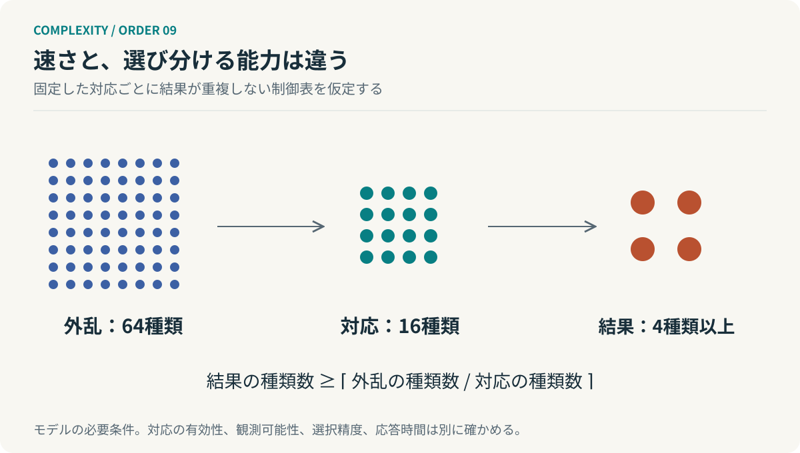

# 第9回　速くするだけでは、制御できない

## アシュビーの必要多様性の法則

<!-- NAV:TOP -->
[← 第8回](08-active-inference.md) | [連載目次](../README.md) | [第10回 →](10-viable-system-model.md)
<!-- /NAV -->

同じ種類の問い合わせが五倍になったなら、窓口の人数や処理速度を増やすことが対策になる。ところが、これまで扱ったことのない問い合わせが五種類増えた場合はどうだろう。回答を知らない担当者が、五倍の速度で応答しても、正しい解決には近づかない。

量を処理する能力と、異なる状態へ適切に対応する能力は違う。AIによる生成を高速化したとき、レビュー体制に何が不足するのかも、この二つを分けて考える必要がある。

W・ロス・アシュビーの必要多様性の法則は、後者の問題を扱う。多様な外乱を制御するには、制御する側にも十分な対応の多様性が要る。これは「複雑な問題には複雑な答え」という格言ではなく、状態と対応を数えることで得られる制約である。[^ashby]

### 種類の数と、情報の量

区別できる状態の集合を $X$ とすると、その対数多様性を次のように表せる。

$$
V_X=\log_2|X|.
$$

16種類なら4ビットである。この定義自体には、各状態が同じ確率で発生するという仮定は必要ない。一方、発生確率を含めて不確実性を測るシャノンエントロピーは、次式になる。

$$
H(X)=-\sum_xp(x)\log_2p(x).
$$

一様分布なら $H(X)=\log_2|X|$ となるが、偏りがあれば小さくなる。珍しい重大障害を含む「取り得る状態の広さ」と、日常の平均的な不確実性は別に管理すべきなのである。

### 制御の限界を、表で考える

外乱の集合を $D$、選べる対応の集合を $R$、対応後の結果を $O$ とする。結果は $o=T(d,r)$ で決まると考える。

ここで、アシュビーが論じた基本的な表の条件を明示する。**同じ対応 $r$ を固定した列では、異なる外乱 $d$ は異なる結果になる**と仮定する。この条件では、一つの結果へ対応づけられる外乱は、対応の種類数 $|R|$ を超えない。全外乱を覆うため、残る結果の種類数には下限がある。[^ashby]

$$
|O|\geq\left\lceil\frac{|D|}{|R|}\right\rceil,
\qquad
V_O\geq V_D-V_R.
$$

64種類の外乱に対し、16種類の対応しかなければ、結果は少なくとも4種類残る。結果を4種類以内に抑えるには、少なくとも16種類の対応が必要になる。

*図9：状態数の下限を示す模型。外乱を見分け、適切な対応を選択できることまで保証する図ではない。*

これは必要条件であって十分条件ではない。16種類の対応を用意しても、どれを選ぶべきか観測できなければ制御できない。対応が遅すぎても役に立たない。反対に、一つの対応で全外乱を安全な同じ結果へ移せる装置なら、上の「列に重複がない」という仮定が成立していない。式だけを、あらゆる制御へ貼り付けてはいけない。

### 上位に、すべてを渡さない

この法則を組織へ応用すると、中央の知識を際限なく増やす以外の方策が見える。局所で解決できる問題は、局所で処理すればよい。

テストの実行エラーは実行環境の担当が復旧する。モジュール内の不具合は担当領域で修正する。外部契約や全体の品質下限を変える判断だけを上位に渡す。上位が直接区別すべき状態は、元の全外乱ではなく、局所処理の後に残る問題になる。

ただし、単に報告を減らすことは外乱を減らすことではない。異常を隠して「すべて順調」と報告すれば、受信するメッセージは単純になるが、制御能力は失われる。**減らすべきなのは、上位の判断に不要な区別である。必要な区別まで失ってはいけない。**

そこで、集約された状態から原データへ戻る経路と、通常の集約を飛び越えて知らせる例外経路が要る。抽象化は詳しい情報を捨てる許可ではなく、普段は詳しく見なくてもよい条件をつくる行為である。

### 二種類の不足を診断する

ここから先は開発組織への設計上の応用である。レビュー待ちが増えたとき、まず流入件数と処理件数を比べる。それでも欠陥の見逃しが増えるなら、欠陥の種類、観点のカバー範囲、診断に必要な観測を調べる。

処理容量の不足なら、並列化や定型検証が効く。対応多様性の不足なら、未知の変更を識別する観点、仕様と照合する方法、専門家へつなぐ経路が必要になる。両方が不足している場合もある。

ここでAIは二つの方向に作用する。診断・検証の手段を増やすこともあれば、人間が想定していなかった変更の種類を増やすこともある。「AIを増やせば制御能力が増える」と一方向に決めつけず、生成側と検証側を別々に測るべきである。

### 単純さより、対応可能性

十個の二値要素が独立なら1,024状態を取る。完全同期し、全要素が同じ値しか取らなければ2状態で済む。こうした制約は扱う状態を減らす一方、独立に振る舞える能力も減らす。同期の維持費用も消えない。

ここに本連載の問いが戻ってくる。複雑さを小さくすることと、複雑な環境へ対応できることは同じではない。対応に必要な複雑さまで取り除くと、わかりやすいが役に立たないシステムになる。

**優れた階層は、全体の能力を貧しくするのではなく、その能力をどこで発揮するかを分ける。**

次回はビーアの生存可能システムモデルへ進む。局所の自律性を守りながら全体を成立させるには、どのような機能と情報経路が必要なのだろうか。

## 参考文献・注記

[^ashby]: W. Ross Ashby（1956）. [An Introduction to Cybernetics](https://ashby.info/Ashby-Introduction-to-Cybernetics.pdf)。Chapman & Hall。第7章および第11章、特に11/5–11/9、印刷頁206–207。

<!-- NAV:BOTTOM -->
---

[← 第8回](08-active-inference.md) | [連載目次](../README.md) | [第10回 →](10-viable-system-model.md)
<!-- /NAV -->
