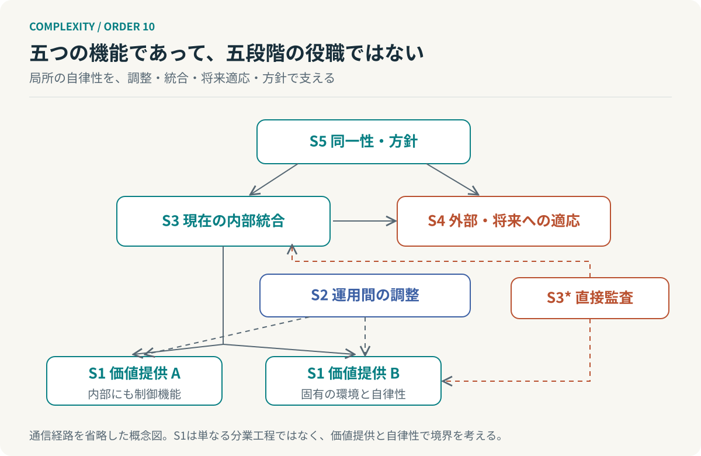

# 第10回　中央がすべてを知らなくても、全体は動く

## ビーアの生存可能システムモデル

<!-- NAV:TOP -->
[← 第9回](09-requisite-variety.md) | [連載目次](../README.md) | [第11回 →](11-second-order-cybernetics.md)
<!-- /NAV -->

開発チームが増えるたびに、責任者の会議も増える。すべての情報が一か所へ集まるため、全体を把握できているように見える。しかし、その人の返事がなければ誰も動けなくなる。情報の集中が、判断の停止に変わっている。

この状態を、管理者が足りないという問題だけで捉える必要はない。局所で扱える問題まで上位へ伝わる構造になっていないか。判断する権限と、その判断を支える観測手段が、現場にあるか。

スタッフォード・ビーアの生存可能システムモデル、VSMは、組織を単なる指揮命令系統としてではなく、環境の変化に対応しながら存続する機能の組合せとして考える。[^beer]

### 五つの番号は、五段階の身分ではない

VSMのSystem 1は、価値を生み出す運用単位である。それぞれが固有の環境に接し、局所的な判断を行う。System 2は、複数の運用単位が互いに干渉し、振動や衝突を起こすことを抑える調整機能である。

System 3は、現在の内部運営を統合し、資源や制約を調整する。System 4は、外部の変化や将来の可能性を観測し、組織の変化を考える。System 5は、同一性と方針を保ち、現在の運営と将来への適応の関係を調整する。[^beer]

*図10：VSMの機能を本連載用に簡略化した図。線は主要な情報・調整経路の例であり、原典の全通信経路を再現したものではない。S3*は第六の指揮階層ではない。*

同じ人が複数の機能を担う場合も、一つの機能を複数の人や機械が担う場合もある。番号をそのまま役職名やAgent名に変えれば完成するわけではない。

### 自律した単位の内側にも、同じ問いがある

VSMでは、生存可能な運用単位をさらに拡大すると、その内側にも運営、調整、適応、方針という機能を見いだせる。この再帰性が、規模をまたいでモデルを使う足場になる。[^beer]

企業のS1を事業、事業のS1を製品や顧客への価値提供単位として捉えることができる。しかし、分業された一工程をすべて独立した生存可能システムと呼ぶ必要はない。コードを書くAgentとテストするAgentを分けただけで、二つの自律したS1が成立したとは限らない。

例えば「受注領域を継続して提供するチーム」をS1と置くなら、その内部に設計、実装、テスト、運用が含まれる。自律性を支えるのは担当工程の狭さではなく、環境に向き合い、結果を確かめ、必要な変更を行える範囲である。

### 例外の数は、どこで減るのか

局所で処理できる外乱を局所で吸収するという考えは、前回の必要多様性とつながる。上位は全外乱を直接扱わず、局所で解決できないものや全体判断を必要とするものを扱う。[^ashby]

この効果を測るために、独自の単純な流量モデルを置いてみる。領域 $i$ の問題流入率を $\lambda_i$、そのうち上位判断を必要とする割合を $p_i$ とする。同じ問題の重複集計を避けるなら、上位へ届く平均流入率は次式になる。

$$
\lambda_{\mathrm{upper}}=\sum_{i=1}^{m}\lambda_i p_i.
$$

これは件数の収支であり、VSMの公式やエントロピーの式ではない。問題の重さ、解決時間、領域をまたぐ相関も表していない。それでも、チームを増やすだけでなく、$p_i$ を下げる局所判断能力へ投資する意味を可視化できる。

もちろん、重大事故まで局所に閉じ込めてはいけない。契約や安全上の制約を越える事象には、通常の報告周期を待たない例外経路が必要になる。局所化と隠蔽は、まったく違う。

### 報告を信じるために、報告だけを見ない

VSMには、System 3から運用の実態へ直接接近する監査機能、S3*がある。通常の報告・集約とは異なる経路から、何が起きているかを確かめる。[^beer]

「テスト完了」という報告と、実際に必要な検証が完了したことは同じではない。成功件数の分母からスキップしたテストが消えていれば、成功率100%でも保証範囲は足りない。

開発システムへの応用なら、報告とCIの実行記録を突合する、設計書とコードの乖離を調べる、品質ゲートの設定自体を確認するといった機能になる。ただし、全件を上位が再実行すれば、局所的な自律性の効果を打ち消す。リスクに応じた抽出、独立した観測、詳しく調べる条件を設計するのである。

### 現在を守る人と、現在を疑う人

S3が現在の方式を安定させようとし、S4が新しい方式を試そうとする。その緊張は失敗ではない。組織が現在と将来の両方を扱っている証拠になり得る。

問題は、現在の効率だけで新しい試みを評価すること、あるいは将来の可能性だけで現行の責任を無視することである。S5が問うのは、何を変えてもよいかではなく、何を守るために、どの変化を許容するかである。[^beer]

AIエージェント群への応用なら、日常の実行と資源配分、方式改善の実験、権限や品質下限を分離する。すべてをLLM同士の会話に任せる必要はない。権限の実効的な強制や停止条件は、決定的な仕組みで担保すべきである。

**自律性を高める設計とは、制御をなくすことではない。どこで制御するかを変えることである。**

それでも、最後に残る問いがある。独立した監査機構が、独立して間違っている場合はどうなるのか。次回は観測者自身を含めて考える第二次サイバネティクスへ進む。

## 参考文献・注記

[^beer]: Stafford Beer（1985）. [Diagnosing the System for Organizations](https://metaphorum.org/staffords-work/viable-system-model)。Wiley。リンク先は研究継承団体Metaphorumのモデル解説。原著と解説を区別して参照。

[^ashby]: W. Ross Ashby（1956）. [An Introduction to Cybernetics](https://ashby.info/Ashby-Introduction-to-Cybernetics.pdf)。Chapman & Hall。第7章および第11章、特に11/5–11/9、印刷頁206–207。

<!-- NAV:BOTTOM -->
---

[← 第9回](09-requisite-variety.md) | [連載目次](../README.md) | [第11回 →](11-second-order-cybernetics.md)
<!-- /NAV -->
