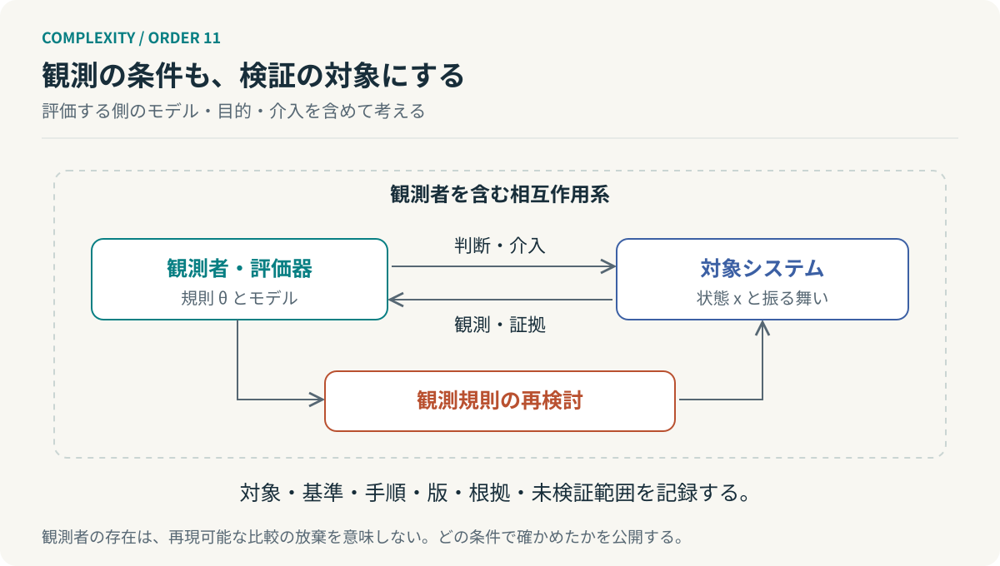

# 第11回　測る側も、測られている系の中にいる

## フォン・フェルスターの第二次サイバネティクス

<!-- NAV:TOP -->
[← 第10回](10-viable-system-model.md) | [連載目次](../README.md) | [第12回 →](12-complexity-and-order.md)
<!-- /NAV -->

同じチームを、コミット数で測ると生産性が高く見え、リリースまでの時間で測ると低く見える。どちらかの数字が偽物とは限らない。見ているものが違うのである。

では、コミット数を評価に使うと宣言したらどうなるだろう。変更を細かく記録する人が増えるかもしれない。測定された値は上がる。しかし、利用者へ届く価値が増えたかどうかは別に確かめなければならない。

これは架空の例だが、一つの重要な問題を含んでいる。測定方法は世界を表すだけでなく、世界への働きかけにもなり得る。観測者を透明な存在として置いたままでは、この変化を説明しにくい。

### 観測される系から、観測する系へ

ハインツ・フォン・フェルスターは、観測されるシステムのサイバネティクスと、観測するシステムのサイバネティクスを区別した。第二次サイバネティクスでは、観測者が行う区別や記述、目的の設定も、考察の対象に入る。[^foerster]

これは第一次を古いものとして捨てる話ではない。温度制御やフィードバックの分析は依然として有効である。ただ、そのモデルは誰が、何を守るために、どこを境界としてつくったのかという問いが加わる。

また、単に「制御器が学習するかどうか」で第一次と第二次を分けるのも正確ではない。適応する制御器を対象にした分析はできる。第二次の特徴は、学習機構の有無だけでなく、観測・記述する側の前提と責任を問いに含めるところにある。

### 同じ世界を、違うものとして測る

観測対象の状態を $x_t$、評価方法の設定を $\theta_t$ と置く。観測値を次のように表すのは、一つの工学的な模型である。

$$
y_t=h_{\theta_t}(x_t)+\varepsilon_t.
$$

$\varepsilon_t$ は観測ノイズである。$x_t$ が変わらなくても、分類や集約の規則 $\theta_t$ が変われば、$y_t$ は変わり得る。

例えば、レビュー指摘をコメント単位で数えていたところから、意味のある欠陥単位で数える方式へ変更する。数が減ったとしても、欠陥が減ったのか、数え方が変わったのかは区別しなければならない。

変更前後を比較するなら、同じサンプルを旧基準と新基準の両方で評価する。対象の変化と測定規則の変化を分けるためである。指標名を同じに保つだけでは、時系列の比較可能性は保てない。

*図11：観測者を含む相互作用の模型。測定条件の明示と外部の証拠による検証経路も含めている。客観的な比較を放棄する図ではない。*

### 観測規則も、動く状態になる

観測に基づいて行動し、その結果を踏まえて観測方法も変える系を、次のように表せる。

$$
\begin{aligned}
y_t&=h_{\theta_t}(x_t)+\varepsilon_t,\\
a_t&=\pi_{\theta_t}(y_t),\\
x_{t+1}&=f(x_t,a_t,w_t),\\
\theta_{t+1}&=g(\theta_t,y_t,a_t,y_{t+1}).
\end{aligned}
$$

これは本稿の説明用モデルであり、フォン・フェルスターの公式ではない。最後の式は直接知ることのできない真の状態ではなく、次に得た観測 $y_{t+1}$ を使う。次の観測は更新前の観測規則で取得してから、規則を更新する順序とする。

制御器の基準が変化すると、対象の振る舞いも変わる。その振る舞いに合わせて基準を更新すると、両者を一つの相互作用系として考える必要が出てくる。

それでも、この数式だけで第二次サイバネティクスを表し切れるわけではない。そもそも $x$ と呼ぶ対象を誰が選び、望ましい結果を誰が決めるのかという問題は、式の外に残る。

### 評価器の上に、評価器を積み続けない

前回のVSMでは、S3*が通常報告とは別に実態を確認した。ところが監査の観点が不足していれば、監査済みという事実は正しさを保証しない。[^beer]

AIレビューAgentなら、既知の欠陥、正常な変更、検出しにくい境界事例を含む固定サンプルで検出能力を確かめられる。変更後も同じ試験を行い、判定の根拠と評価器の版を残す。

ただし、既知サンプルへの適合だけでは、未知の欠陥を検出できるとは限らない。開発側が評価基準へ適応した結果、評価では見えない欠陥へ偏る可能性も検討する必要がある。未知期間の評価、基準とは独立した実行証拠、運用で発見された欠陥との照合を分けて持つのである。

評価器を検証する評価器を増やすだけでは、問題を一段上へ移しているにすぎない。全対象 $n$ を全評価者 $m$ が評価する構造なら、評価関係は $mn$ 本になる。$m$ も $n$ に比例すれば二次的に増える。これは関係数の計算であり、検証の正確さが増えることを意味しない。

必要なのは無限の監査階層ではなく、対象と評価器と方針を分け、どこに独立した証拠を置き、誰が残余リスクを引き受けるかを決めることである。

### 客観性は、条件を見えるようにする仕事である

観測者がいるから何も確かめられない、という結論に進む必要はない。観測の対象、基準、手順、ツールの版、未検証範囲を明示すれば、他の観測者が比較・再実行できる。

この連載で行ってきた理論の接続も、同じ条件を負っている。物理学の式と組織の比喩を並べたからといって、組織が物理法則どおりに動くことが証明されたわけではない。どこまでが元の理論で、どこからが私たちの解釈かを分けなければならない。

**システムを説明する図の外側に、図を描いている人がいる。その人もまた、説明を通じてシステムに参加している。**

これで、連載は出発点を違う角度から見られるところまで来た。最終回では、複雑さを減らそうとした私たちが、何を増やしてきたのかを振り返る。

## 参考文献・注記

[^foerster]: Heinz von Foerster（1979）. [Cybernetics of Cybernetics](https://cepa.info/fulltexts/1707.pdf)。In K. Krippendorff (ed.), Communication and Control in Society, pp. 5–8。

[^beer]: Stafford Beer（1985）. [Diagnosing the System for Organizations](https://metaphorum.org/staffords-work/viable-system-model)。Wiley。リンク先は研究継承団体Metaphorumのモデル解説。原著と解説を区別して参照。

<!-- NAV:BOTTOM -->
---

[← 第10回](10-viable-system-model.md) | [連載目次](../README.md) | [第12回 →](12-complexity-and-order.md)
<!-- /NAV -->
