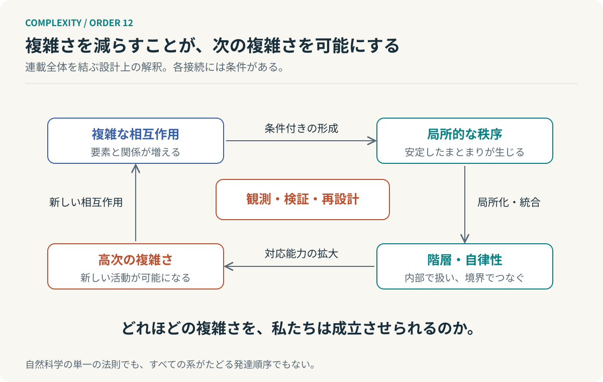

# 第12回　複雑さは、なぜ秩序を生むのか

## 階層、自己組織化、そして自律するシステム

<!-- NAV:TOP -->
[← 第11回](11-second-order-cybernetics.md) | [連載目次](../README.md) | 最終回
<!-- /NAV -->

### 複雑なものを、単純にする

複雑なものを前にすると、私たちはそれを単純にしようとする。

問題の分解、要素の分類、関係の整理。組織であれば部署を分け、ソフトウェアであればモジュールに分割する。複雑さは取り除くもので、単純さは望ましいものだと考えている。

しかし少し考えてみると不思議なことがある。一人ではできない仕事を、チームではできる。単独の部品にはない働きを、組み合わせた装置は実現する。要素と関係を増やしたはずなのに、それまで不可能だったことが可能になる。

複雑さが増えるほど混乱が増えるとは限らない。むしろ複数の要素が関係を持つことによって初めて成立する秩序がある。

この連載では複雑度のオーダーと階層性を出発点として、十一の理論的な視点をたどってきた。最終回ではそれらを一つの問いへ戻してみたい。

複雑なものは、なぜ複雑なままで成立できるのだろうか。

### 全体は、部品の一覧ではない

最初の手がかりはベルタランフィの一般システム理論にある。全体の振る舞いを理解するには、要素を孤立させて調べるだけでなく相互作用の組織を扱う。[^bertalanffy]

時計を分解すると歯車やぜんまいが現れる。机の上にそれらを並べても、時計としては動かない。機能は部品が特定の関係を持つことで成立する。

同じ発想を組織へ移してみる。優秀な人を集めることと、優れた判断ができる組織をつくることは同じ仕事ではない。それぞれの能力に加えて、情報を誰へ渡し誰が何を決めるのかという関係が要る。

ここで複雑さの主語が変わる。要素が多いことだけでなく、要素同士が関係を持ち、その関係の変更が別の関係へ伝わることが問題になる。

全ペアを無向の関係として数えるなら、要素数 $n$ に対して、関係数は次式で増える。

$$
E(n)=\frac{n(n-1)}{2}.
$$

10要素なら45、100要素なら4,950、1,000要素なら499,500である。これは実際の工数を直接表してはいないが、すべてをすべてと直接調整する方式が規模に弱い理由を示す模型にはなる。

それでも大きなシステムは存在する。そこにはすべてを一度に扱わなくても済む構造がある。

### 階層は、複雑さの結果でもある

サイモンは複雑なシステムを、内部で強く関係し外部とは比較的弱く関係するサブシステムとして捉えた。準分解可能性があれば、短い時間の振る舞いを部分ごとに理解し、長い時間では部分間の相互作用を考慮できる。[^simon]

階層とは単に上から命令を伝えるための構造ではない。下位の詳細を上位から一つのまとまりとして扱えるようにする構造でもある。

百人の全員があらゆる判断について互いに確認する必要はない。局所的な問題をチーム内部で解決できるなら、チーム間では必要な情報を交換すればよい。階層化とは要素を減らすことではなく、同時に考慮する関係を減らすことである。

ただし部署を分けても、すべての決定に他部署の承認が要るなら効果はない。図が分かれたことと仕事が分かれたことは違う。

さらにサイモンの時計職人の比喩は、部分組立が途中の成果を保つことにも目を向ける。階層は完成したものを理解する方法であるだけでなく、複雑なものが成立する過程を支えてもいる。[^simon]

そこでもう一つの疑問が生まれる。そもそもそのようなまとまりは、なぜ生まれるのだろうか。

### 秩序は、流れの中にも生まれる

プリゴジンの散逸構造論は、秩序を変化の止まった状態だけに閉じ込めない。非平衡状態における不可逆過程は、条件によって巨視的な秩序の形成と維持に関わる。[^prigogine]

下から加熱された液体に規則的な対流が現れる。流れの形を個別に指定した者はいない。温度差や流体の相互作用によってパターンが成立し、外部からの供給と散逸が続く間はその運動が保たれる。

ここで秩序のイメージが反転する。秩序は変化を止めることだけではない。変化し続ける要素が一定の関係を保っている状態でもある。

もちろん非平衡なら必ず秩序が生まれるわけではない。数学的なカオスと日常語の混乱も別物である。まして対流パターンが生まれることと組織の階層が生まれることは、別である。

それでも一つの発想は受け取れる。既存の秩序を崩す変化が、次の秩序の成立条件にもなり得る。

### 多数の要素が、一つの動きをする

ハーケンのシナジェティクスは、協同する多数の要素を少数の秩序変数で記述できる場合を扱う。速く緩和する安定な変数と遅い変数が分離できる条件では、全体の振る舞いを低次元で近似できる。[^haken]

ここで起きているのは部品が消えることではない。それぞれを独立の自由度として扱わなくてもよい状態が生まれるのである。

サイモンが相互作用を局所化して部分ごとに理解する道を示したのに対し、ハーケンは動きの協調によって実効自由度を縮約する道を示す。構造による縮約と、振る舞いによる縮約。この二つを混同しなければ、なぜフォルダを増やしても問題が簡単にならないのかと、なぜ大量の測定値を少数の状態で説明できる場合があるのかを別々に考えられる。

ただし全センサーを読む費用は縮約したモデルの外に残る。少数の変数で記述できることと、必要な仕事のすべてが安くなることは違う。

### 自分自身をつくり続ける

一時的なパターンが続くことと、そのパターンを成立させる仕組みを自ら生産することも違う。マトゥラーナとヴァレラのオートポイエーシスは、構成要素を生産する過程がその構成要素によって再び実現される組織に注目した。細胞を考えるなら、代謝が構成物質や境界の形成に関わり、それらが代謝を続ける条件を成立させる。[^autopoiesis]

ここで自律性は孤立とは別の意味になる。外部から物質やエネルギーを受け取りながら、内部の生産過程が循環して組織を保つ。外部を必要としないのではなく、外部と関わりながら自らを成立させる過程を保つのである。

カウフマンの自己触媒集合も、相互に生成を促進するネットワークを考える足場になる。個々の分子が単独で自分を複製する必要はない。複数の反応が互いに支え合う集合として成立する可能性を問う。[^kauffman]

ただし反応集合の形式的な条件を満たすことは、その場で起動して必要な速度で維持されることまで保証しない。資源と反応速度と初期の触媒と境界は、別に検討する条件として残る。[^raf]

### 成立させる結合が、変化を妨げる

相互依存にはもう一つの顔がある。カウフマンとワインバーガーのNKモデルでは、要素の評価がほかの要素の状態にも依存する。標準的なランダムモデルではその依存が増えると、局所的な改善だけで適応することが難しい地形になりやすい。[^nk]

ある部分を変えると別の部分の評価が変わる。ここを直せばあちらが悪化する。局所の正解を集めれば全体の正解になる、とは限らない。

自己触媒集合の触媒関係とNKモデルの評価への依存は、同じ種類の関係ではない。それでも二つを並べると設計上の緊張が見えてくる。

システムを成立させるために必要な結合が、そのシステムを変更するときの負担にもなり得る。だからこそ関係をなくすのではなく、関係を配置するのである。内部では必要な結合を保ち、外部への変更伝播を限定する。高凝集・疎結合を単なる美しさではなく、成立可能性と変更可能性を両立させる試みとして考えられる。

### 規則に従うものが、規則を書く

ホフスタッターのストレンジループは階層を別の角度から揺さぶる。異なる抽象レベルをたどっていくと、自己参照によって出発点へ戻ってくる。規則に従って扱われる記号が、規則や体系自身について語る対象にもなる。[^hofstadter]

単に循環することとは違う。温度調節のフィードバックも関数の再帰呼び出しも、それだけでストレンジループにはならない。

それでもこの視点はAIエージェントの自己改訂を考える際に役立つ。Agentがコードを修正するだけでなく、コードを書くときに使うSkillを改訂するなら、変更の対象は成果物から生成規則へ移る。

そこで何をもって改善とするかが問題になる。自分の成績表を書き換えて成績を上げることと、能力を改善することは違う。実行規則を変更する権限と評価基準を変更する権限を分ける理由が、ここにある。

### 予測し、行動し、また予測する

フリストンの自由エネルギー原理と能動的推論は、不確実な環境についての推定と行動選択を考える枠組みを与える。内部の生成モデルで観測を説明し、そのモデルに関する信念を更新し、さらに望ましい結果と情報獲得を考慮して行動を評価する。[^friston] [^active]

テストに失敗したなら、すぐコードを書き直すことだけが行動ではない。ログを調べることも、仕様を読み直すことも、異なるデータで再実行することもできる。何が起きたか分からないときには、先に何を知るかを選ぶ価値がある。

この枠組みも、すべてのAgentが同じ計算を実行せよという万能処方ではない。モデルの中で説明が整うことと、そのモデルが現実に適合していることは別に確かめる。

それでも自律性の見方は広がる。自分で動けることに加え、何が分かっていないかを捉えて次の観測を選べることが重要になる。

### 中央がすべてを知らなくてもよい

アシュビーの必要多様性の法則は、制御側に必要な対応能力の下限を考えさせる。多様な外乱を区別して抑えるにはそれに見合う対応が要る。条件を明示したモデルでは、結果に残る多様性を外乱と制御器の多様性の関係として評価できる。[^ashby]

ただしその能力を一人に集中させる必要はない。ビーアのVSMは、価値を生む運用と単位間の調整と現在の内部統合と将来への適応と方針の維持という機能を配置する。各自律単位の内部にも、同じ機能上の問いを再帰的に適用する。[^beer]

こうして階層は中央の支配を強めるだけの構造ではなくなる。中央がすべてを直接判断しなくても全体を成立させる構造になる。

権限委譲とは仕事を下位へ渡すだけのことではない。局所の環境を観測して判断し、結果を検証し、必要な問題を上位へ知らせる能力を渡すことでもある。

上位の役割はすべてを知ることではない。何を知らなくてもよいか、どの例外だけは知らなければならないかを設計することである。

### 図の外側に、誰がいるのか

最後にフォン・フェルスターの第二次サイバネティクスが、ここまでの議論を観測者へ返す。システムを記述する側の区別もモデルも目的も、考察から免除されない。[^foerster]

何を測定するかを選び、何を一つの単位として扱うかを決める。その判断に基づいて介入すれば、観測者は対象の振る舞いを変える要因になる。

品質評価Agentがあることと、品質を正しく評価できることは違う。評価器の版と観点と根拠と未検証の領域を明示し、別の観測から確かめる経路が要る。

客観性を諦める話ではない。誰が測っても同じだと先に宣言するのではなく、何をどの条件で測ったかを開いて比較と反証ができるようにする仕事である。

そしてこの連載も例外ではない。異なる理論の共通点を見いだしたのは観測する側である。物理学の法則と形式的なモデルと認知についての概念と組織設計の枠組みは、一つの普遍法則にはならない。つながりは検証を免除する証明ではなく、次に何を検証するかを考えるための仮説である。

### 複雑さを、なくさない

*図12：連載全体の解釈を表す概念図。各矢印は条件付きの接続であり、必然的な発達段階や単一の科学法則ではない。*

振り返れば、複雑さの見方は少しずつ変わってきた。最初は複雑さをいかに減らすかという問題だった。やがて、相互作用から秩序が生まれる場合があると分かってくる。局所的な秩序を一つの単位として扱えれば階層をつくれる。構成過程を維持できれば、自律性が問いになる。環境を推定し、自分の規則を対象化すれば、適応や自己改訂という問題が現れる。

そしてそれらを観測する主体も、同じ世界の内側にいる。

関係を無差別に切れば、成立に必要な協調まで失われる。重要なのは、どの複雑さを内部で引き受け、どの変化を外部へ伝え、何を新しいまとまりとして扱うのかを決めることである。

ここでいう「複雑さ」は一つの数値ではなかった。関係数、状態空間、実効自由度、制御の多様性、観測に必要な情報。何を減らしたのかとどこへ負担を移したのかを区別しなければ、改善を語ることはできない。それでも連載を通じた設計上の立場は明確である。

**優れたシステムは、必ずしも単純なシステムではない。必要な複雑さを持ち、そのすべてを、すべての参加者へ負わせないシステムである。**

新しいまとまりができれば、そのまとまり同士の相互作用が始まる。局所の複雑さを扱えるようになったことで、より大きな活動が可能になる。その活動はまた新しい複雑さを生む。

私たちは複雑さを取り除くために階層をつくっているつもりだった。しかし階層をつくることによって、さらに大きな複雑さを扱う能力も得ていた。複雑さを減らすための行為が、複雑さを増やせる条件を生んでいたのである。

この連載も、一つの問いから始まり、異なる理論へ分岐し、それぞれの関係をたどるうちに、一つのまとまりになった。そのまとまりから、最初とは少し違う問いが生まれている。

**複雑さをどう減らすか、ではない。**

**どれほどの複雑さを、私たちは成立させることができるのか。**

その問いを、次の設計の出発点としたい。

## 参考文献・注記

[^simon]: Herbert A. Simon（1962）. [The Architecture of Complexity](https://www.jstor.org/stable/985254)。Proceedings of the American Philosophical Society, 106(6), 467–482。階層と準分解可能性。

[^bertalanffy]: Ludwig von Bertalanffy（1968）. [General System Theory: Foundations, Development, Applications](https://www.panarchy.org/vonbertalanffy/systems.1968.html)。George Braziller。リンク先は原著の抜粋。全体性・開放系・等結果性。

[^prigogine]: Ilya Prigogine（1977）. [Time, Structure and Fluctuations](https://www.nobelprize.org/uploads/2018/06/prigogine-lecture.pdf)。ノーベル講演。非平衡・散逸・不安定性を扱う。

[^haken]: Hermann Haken（1996）. [Slaving principle revisited](https://doi.org/10.1016/0167-2789(96)00080-2)。Physica D, 97, 95–103。秩序変数と隷属原理。

[^autopoiesis]: Francisco G. Varela, Humberto R. Maturana, Ricardo Uribe（1974）. [Autopoiesis: The organization of living systems, its characterization and a model](https://pubmed.ncbi.nlm.nih.gov/4407425/)。BioSystems, 5(4), 187–196。DOI: 10.1016/0303-2647(74)90031-8。

[^kauffman]: Stuart A. Kauffman（1986）. [Autocatalytic sets of proteins](https://pubmed.ncbi.nlm.nih.gov/3713221/)。自己触媒集合の基礎文献。

[^raf]: Wim Hordijk, Mike Steel（2004）. [Detecting autocatalytic, self-sustaining sets in chemical reaction systems](https://doi.org/10.1016/j.jtbi.2004.02.020)。Journal of Theoretical Biology, 227(4), 451–461。RAFの形式化と検出。

[^nk]: Stuart A. Kauffman, Edward D. Weinberger（1989）. [The NK model of rugged fitness landscapes and its application to maturation of the immune response](https://pubmed.ncbi.nlm.nih.gov/2632988/)。Journal of Theoretical Biology, 141(2), 211–245。

[^hofstadter]: Douglas R. Hofstadter（2007）. [I Am a Strange Loop](https://www.hachettebookgroup.com/titles/douglas-r-hofstadter/i-am-a-strange-loop/9780465030798/)。Basic Books。概念枠組みとして参照。前著 Gödel, Escher, Bach（1979）も背景にある。

[^friston]: Karl Friston（2010）. [The free-energy principle: a unified brain theory?](https://www.nature.com/articles/nrn2787)。Nature Reviews Neuroscience, 11, 127–138。DOI: 10.1038/nrn2787。

[^active]: Ryan Smith, Karl J. Friston, Christopher J. Whyte（2022）. [A step-by-step tutorial on active inference and its application to empirical data](https://pmc.ncbi.nlm.nih.gov/articles/PMC8956124/)。Journal of Mathematical Psychology, 107, 102632。方策評価・期待情報利得の補足。

[^ashby]: W. Ross Ashby（1956）. [An Introduction to Cybernetics](https://ashby.info/Ashby-Introduction-to-Cybernetics.pdf)。Chapman & Hall。第7章および第11章、特に11/5–11/9、印刷頁206–207。

[^beer]: Stafford Beer（1985）. [Diagnosing the System for Organizations](https://metaphorum.org/staffords-work/viable-system-model)。Wiley。リンク先は研究継承団体Metaphorumのモデル解説。原著と解説を区別して参照。

[^foerster]: Heinz von Foerster（1979）. [Cybernetics of Cybernetics](https://cepa.info/fulltexts/1707.pdf)。In K. Krippendorff (ed.), Communication and Control in Society, pp. 5–8。

<!-- NAV:BOTTOM -->
---

[← 第11回](11-second-order-cybernetics.md) | [連載目次](../README.md) | 最終回
<!-- /NAV -->
