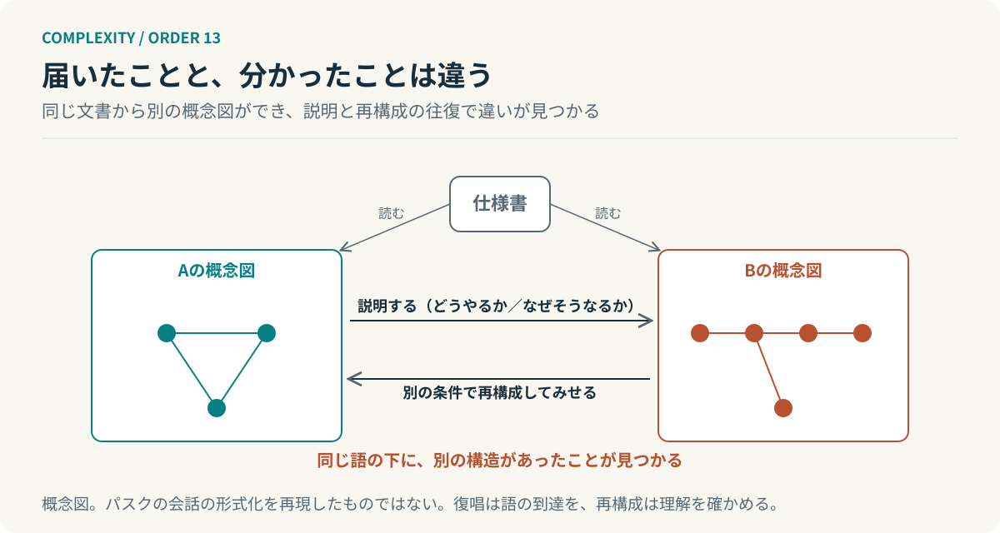

# 第13回　同じ言葉を使っていても、同じことを考えてはいない

## パスクの会話理論と、理解を確かめる循環

<!-- NAV:TOP -->
[← 第12回](12-complexity-and-order.md) | [連載目次](../README.md) | [第14回 →](14-learning-levels.md)
<!-- /NAV -->

仕様書を共有した。全員が了解している。それでもできあがったものは違っていた。読み合わせの席では誰も異を唱えず、同じ語で同じ箇所を指していたはずである。届いたのは同じ一枚の文書で、受け取られた理解は別々だった。

第1クールの最終回は「図を描く側も図の中にいる」というところで止まった。そこから第2クールを始める。図の中に観測者が二人いるとき、二人は互いの見ている世界をどう確かめ合うのか。パスクの会話理論は理解を頭の中の状態としてではなく、二者のあいだで確かめられる手続きとして扱う。[^pask]

### 届くことと、分かることは別である

文書は届く。読まれもする。だが読まれたことと理解されたことは、同じ検査では確かめられない。復唱なら確かめられる。相手が要点を言い直せば少なくとも語は届いている。ところが復唱は同じ語を同じ順で返す作業であって、別の場面でその概念を使えるかまでは示さない。

パスクが会話理論で問題にしたのはこの差である。理解とは受け取った説明を自分で再構成し、求められれば別の条件でも組み立て直せることだとされる。言い換えれば理解は合意の宣言ではなく、再構成の実演によって確かめられる。[^pask]

### 会話は、二つの水準で進む

パスクの会話は二人の参加者がある主題について交わすやりとりである。会話理論はこの交わりを二つの水準に分けて記述している。「どうやるか」の水準では、手順や操作を説明して実演する。「なぜそうなるか」の水準では、その手順が成り立つ理由を主題の他の概念との関係から説明する。[^pask]

二つを分けるのは片方だけでは理解を確かめられないからである。手順だけを真似られても、条件が変わったときに手順を組み替えられるかは分からない。理由だけを語れても実際に組み立てられるとは限らない。会話理論が教え返しと呼ぶ手続きはこの二つを相手に実演させるもので、教えられた側が今度は教える側に回って説明し、組み立ててみせる。ここで立場が入れ替わる。[^pask]

*図13：会話理論の概念図。復唱は語が届いたことを、再構成は理解が成立したことを確かめる。パスクの会話の形式化を再現したものではない。*

本連載が借りるのは形式化された会話の体系そのものではない。相手の再構成を通じてしか理解を確かめられない、という一点である。パスクの理論には主題を概念の関係として表す装置や学習の進め方の型の区別もあるが、本連載ではそこへ立ち入らない。[^manning]

### 読み合わせが、確認にならない理由

冒頭の読み合わせに戻ると、そこで行われていたのは復唱に近い。仕様書の各項を読み上げ、異議がないことを確かめる。これは語が届いたことの確認であって、再構成の実演ではない。ある人は「冪等」を「二回呼んでも結果が同じ」と読み、別の人は「二回呼んでも副作用が一回分」と読む。読み合わせではどちらも頷く。

違いが見つかるのは各自が仕様から具体例をつくったときである。「この入力ならこう返す」という例を出し合えば、同じ語の下に別の構造があったことが露わになる。文書は一つでも、各自が組み立てた概念図は二つあった。会話理論の言葉では、理解の確認は文書の共有ではなく再構成の交換によって成立する。[^pask]

第11回で測る側も測られる系の中にいると述べた。観測者が二人いればそれぞれの区別の仕方が違う。違いそのものは消せない。消せないからこそ違いを見つける手続きが要る。

### 手続きとして、何を共有するか

開発組織へ移すと共有するものが二つに分かれる。文書と、理解の違いを発見する手続きである。後者はたとえば次の形をとる。仕様を受け取った側が仕様に書かれていない入力に対する振る舞いを自分の言葉で説明し、境界の例を一つ作って書いた側に投げ返す。書いた側はその例が自分の意図と合うかを答える。合わなければ、そこに違いがある。

AIエージェントへ応用するなら要約を返させるだけでは復唱に留まる。別の条件での具体例や反例やテストケースを生成させて人が検査する方が、再構成の実演に近い。ただしこれは会話理論からの工学的な類推であって、パスクが定式化した手続きをそのまま実装したものではない。

**共有するものは文書だけではない。理解の違いを発見する手続きも、共有の対象である。**

読み合わせの席に戻る。全員が頷いた仕様書は机の上にまだ一枚のままある。その一枚から、何枚の図が描かれていたのか。頷きでは数えられない。

## 参考文献・注記

[^pask]: Gordon Pask（1976）. [Conversation Theory: Applications in Education and Epistemology](https://monoskop.org/log/?p=2376)。Elsevier。リンク先は書誌と紹介。理解を再構成の実演として確かめる「教え返し」と、二つの水準の会話。原文は今回未取得で、二次資料の要約と照合した範囲で記述した。

[^manning]: Paul Manning（2023）. [What is conversation theory?](https://discovery.ucl.ac.uk/id/eprint/10181184)。Cybernetics & Human Knowing。UCL Discovery の記録。会話理論を概念の形成と共有の過程として導入する論文。

<!-- NAV:BOTTOM -->
---

*次回　第14回「答えを直しているかぎり、解けない問題がある」。失敗を減らすことと、失敗を生む前提を変えることは、どう違うのか。*

[← 第12回](12-complexity-and-order.md) | [連載目次](../README.md) | [第14回 →](14-learning-levels.md)
<!-- /NAV -->
