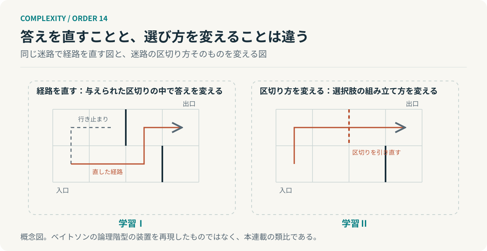

# 第14回　答えを直しているかぎり、解けない問題がある

## ベイトソンの学習階層と、学び方を学ぶこと

<!-- NAV:TOP -->
[← 第13回](13-conversation-theory.md) | [連載目次](../README.md) | [第15回 →](15-information-bottleneck.md)
<!-- /NAV -->

指摘を減らそうと確認項目を増やした。指摘は減る。代わりにレビューが滞るようになった。項目を一つ増やすたびに確認の時間が伸び、滞りを減らすためにまた項目を見直す。改善は続いているのに同じ場所を回っている。

ベイトソンは学習をいくつかの水準に分けて論じた。[^bateson] 本連載が借りるのは、与えられた選択肢の中で答えを直すことと、選択肢の組み立て方そのものを変えることの区別である。前回、理解の違いを見つける手続きを扱った。今回はその手続きを含めて何を学習と呼ぶかを一段ずらす。

### 答えを直す学習と、選び方を変える学習

ベイトソンの区分では、学習Ⅰはある文脈の中で応答を変えることである。条件づけや正解と見なされた応答の獲得がここに入る。学習Ⅱはその学習Ⅰが起こる文脈の捉え方を身につけることで、選択肢の集合がどう組み立てられているかを学ぶ。学び方を学ぶと言い換えられる。学習Ⅲは学習Ⅱで身についた前提の体系そのものが変わる水準で、ベイトソン自身はこれを稀なものとし、実験で調べられるかには懐疑的だった。[^bateson]

本連載は論理階型の装置そのものには立ち入らない。借りるのは一点である。同じ「学ぶ」という語の下に、選択肢の中で答えを変える活動と、選択肢の組み立て方を変える活動がある。二つは別の水準にあり、片方をいくら積み重ねても、もう片方には届かない。

*図14：学習Ⅰと学習Ⅱの対比。左は与えられた区切りの中で経路を直し、右は区切りを引き直す。ベイトソンの論理階型の装置を再現したものではなく、本連載の類比である。*

### 項目を増やすのは、どの水準か

確認項目を増やすのは学習Ⅰにあたる。「レビューとは項目の照合である」という文脈は固定したまま、その中で応答を調整している。指摘が出れば、項目を足す。滞れば削る。どちらも同じ区切りの中の往復である。

学習Ⅱの変化は文脈の捉え方を変える。レビューを照合の場ではなく、変更の意図と影響範囲を書いた本人に説明させる場として組み替える。項目の数は問題にならなくなる。前回の言葉で言えば、復唱の確認から再構成の確認へ移ることが、ここでは文脈の変更にあたる。

### 改善が続くほど、前提は見えなくなる

学習Ⅱで身についた文脈の捉え方は成功するほど自明になる。項目を照合すれば品質が保たれた経験が重なると、照合という形式は疑われなくなる。改善の指標が上がり続けている間は、なおさらである。さらに指標は文脈の内側で定義されているから、文脈の外にある問題を映さない。

第7回で、規則に従うものが規則を書き換える構造を扱った。評価基準を変える権限と実行規則を変える権限を分けよ、というのがそこでの提案だった。今回の区分で言えば、実行規則の書き換えは学習Ⅰの延長であり、評価基準の書き換えは学習Ⅱに近い。何を学習と呼ぶかを決めること自体が、どの水準で話しているかの宣言になる。

### 前提を疑う能力は、別に育てる

開発組織へ移すと二つの仕組みが要る。改善の仕組みと、改善の前提を疑う仕組みである。前者は指標と振り返りで回っていく。後者には、指標が測っていないものを言葉にする場や、レビューの目的そのものを問い直す機会が要る。頻度は低くてよいが改善の仕組みの中には組み込めない。組み込めばそれもまた項目になる。

AIエージェントの自己改善ループは、評価指標に対して出力を調整する限りで学習Ⅰにあたる。指標の定義や文脈の設計を変えるのは今のところ人の仕事である。これはベイトソンの理論からの類推であって、エージェントの学習を分類する確立した枠組みではない。

**改善を続ける能力と、改善の前提を疑う能力は、別の能力である。**

確認項目の一覧に戻る。項目は三十を超えた。そのどれも間違ってはいない。間違っているとすれば、項目で確かめるという考えの方である。三十の項目は、何を前提にして正しいのか。

## 参考文献・注記

[^bateson]: Gregory Bateson（1972）. [Steps to an Ecology of Mind](https://press.uchicago.edu/ucp/books/book/chicago/S/bo3620295.html)。Chandler / University of Chicago Press。所収の "The Logical Categories of Learning and Communication"（1964）。学習0〜Ⅲの区分。原文は今回未取得で、二次資料の要約で照合した。

<!-- NAV:BOTTOM -->
---

*次回　第15回「情報を減らしたら、判断できるようになった」。理解に必要なのは、できるだけ多くの情報なのか。*

[← 第13回](13-conversation-theory.md) | [連載目次](../README.md) | [第15回 →](15-information-bottleneck.md)
<!-- /NAV -->
