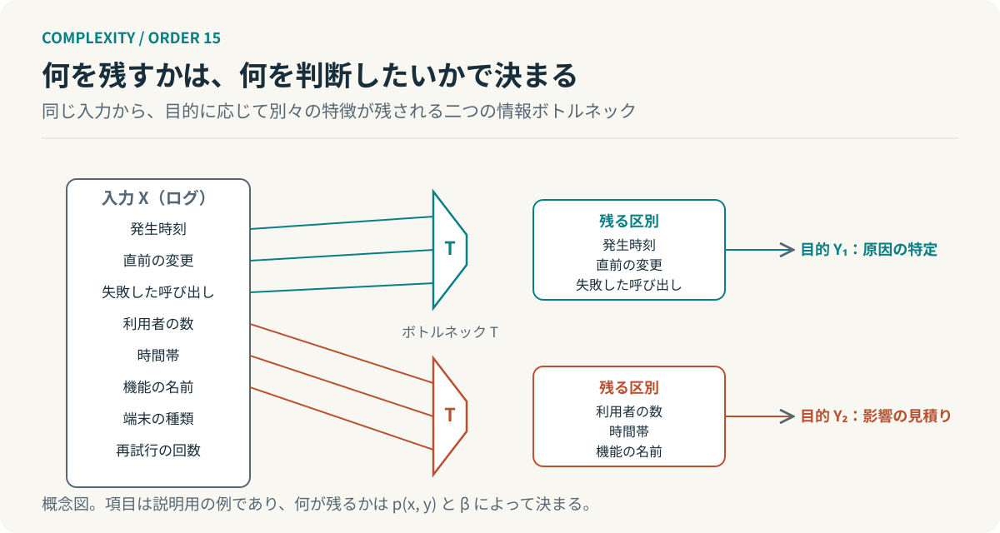
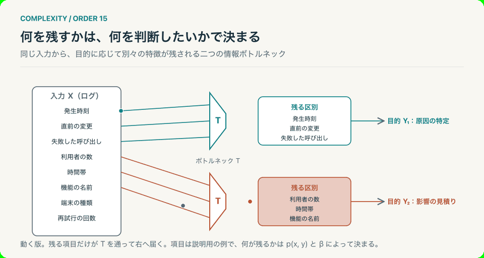

# 第15回　情報を減らしたら、判断できるようになった

## 情報ボトルネックと、何を残すかという設計

<!-- NAV:TOP -->
[← 第14回](14-learning-levels.md) | [連載目次](../README.md) | [第16回 →](16-causal-emergence.md)
<!-- /NAV -->

膨大なログを渡された。障害の原因を探すためである。すべてが記録されているのに、何から見ればよいか分からない。誰かがログを四つの項目に整理した。発生時刻、直前の変更、失敗した呼び出しの種類、影響した利用者の数。それで次の行動が決まった。情報は減ったのに判断はできるようになった。

ティシュビーとペレイラとビアレックの情報ボトルネック法は、この経験を一つの最適化として書く。入力の情報量を抑えながら、予測したい対象についての情報を保つ圧縮である。[^tishby]

### 短くすることと、残すことは別である

要約には二つの性質がある。短いことと目的に役立つことである。二つは同じ方向を向くとは限らない。四つの項目は短い。だが短いから役立ったのではない。原因を探すという目的に必要な区別を残していたから役立った。

第4回では多数の変数を少数の秩序変数で記述できる条件を扱った。第9回では対応に必要な多様性まで削ると制御できなくなることを見ている。今回の問いはその間にある。何を残し、何を省けば、目的に対して十分な区別が保たれるのか。

### 何に対して、何を残すか

入力を $X$、予測したい対象を $Y$、要約を $T$ とする。情報ボトルネック法は、$X$ から $T$ をつくる確率的な写像 $p(t\mid x)$ を、次を最小にするように選ぶ。[^tishby]

$$
\min_{p(t\mid x)}\; I(X;T)-\beta\,I(T;Y).
$$

$I$ は相互情報量である。第一項は要約が入力について持つ情報で、小さいほど短い。一方で第二項は要約が目的について持つ情報で、大きいほど役立つ。$\beta$ は両者の重みで、小さければ極端に短い要約が選ばれ、大きければ詳細が残る。これは文献にある原式であり、$X$ と $Y$ の同時分布が与えられていることを前提にする。

ログに当てはめるなら前提の方が先に効く。$Y$ が定義されていなければ、第二項は計算できない。何を判断したいかを決めずに要約を頼むと短さだけが残る。

### 目的が変われば、残すものも変わる

同じログでも目的が違えば残る項目は違う。原因を特定したいなら発生時刻と直前の変更と失敗した呼び出しが残り、影響範囲を見積もりたいなら利用者の数と時間帯と機能の名前が残る。入力は一つで、よい要約は二つある。

*図15：二つの目的に対する情報ボトルネックの概念図。項目は説明用の例であり、実際に何が残るかは同時分布と $\beta$ によって決まる。*

*図15-動：目的ごとに残る項目だけが T を通って届く。上の T と下の T で3秒ずれて一周する。*

だから「よい要約」は目的に相対的である。万能の要約を一つ作って配るより、判断ごとに残す区別を決める方が、式の前提に合っている。

### 要約の設計は、判断の設計である

開発組織へ移すと、要約を書く前に決めることが一つ増える。この要約で誰が何を判断するのか、である。それが決まれば残す項目はかなりの部分まで決まる。決まらなければ長い要約と短い要約のどちらも役に立たない。

AIエージェントに渡す文脈も同じ構造を持つ。入力を増やせば判断が良くなるとは限らず、判断させたいことに必要な区別が入っているかが効く。第9回の「必要な区別まで失わない」が、ここでは「必要な区別だけを残す」と対になる。ただし情報ボトルネック法は最適化の枠組みであって、人や組織の判断を記述する理論ではない。

**よい要約とは、短い要約ではない。目的に必要な区別を残した要約である。**

ログに戻る。四つの項目はログのほとんどを捨てて残った。捨てたものが消えたわけではない。誰かが何のために見るのかを先に決めたから、残す四つが決まったのである。別の問いを立てたとき、同じ四つが残るだろうか。

## 参考文献・注記

[^tishby]: Naftali Tishby, Fernando C. Pereira, William Bialek（1999）. [The information bottleneck method](https://arxiv.org/abs/physics/0004057)。37th Allerton Conference。arXiv:physics/0004057。圧縮と目的に関する情報の保持を一つの最適化として定式化する。

<!-- NAV:BOTTOM -->
---

*次回　第16回「細かく見れば、原因が分かるとは限らない」。最も詳細な説明は、常に最も有効な説明なのか。*

[← 第14回](14-learning-levels.md) | [連載目次](../README.md) | [第16回 →](16-causal-emergence.md)
<!-- /NAV -->
