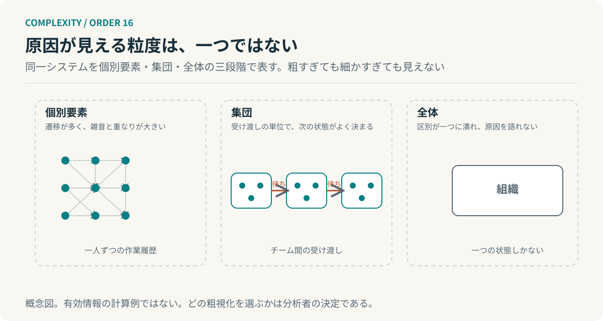

# 第16回　細かく見れば、原因が分かるとは限らない

## 粗視化と因果創発――説明に適した階層を選ぶ

<!-- NAV:TOP -->
[← 第15回](15-information-bottleneck.md) | [連載目次](../README.md) | 第17回（準備中）
<!-- /NAV -->

遅延の原因を探して作業履歴を一人ずつ追った。誰のどの作業にも遅れは見つからない。見方を変えてチーム間の受け渡しを数えると、遅延は受け渡しの待ち時間に集中していた。個人の履歴には待ちは記録されない。

ホーエルとアルバンタキスとトノーニは、同じ系を別の粒度で記述したときに原因の強さがどう変わるかを測る方法を提案した。[^hoel] 前回、何を残すかを扱った。今回はそれをどの単位で残すかへ進める。

### 同じ系を、別の粒度で記述する

微視的な記述は各要素の状態を一つずつ追う。一方で巨視的な記述は、いくつかの状態をまとめて一つの状態として扱う。このまとめ方を粗視化と呼ぶ。一人ひとりの作業履歴は微視的な記述で、チームを単位にした受け渡しの記録は、その粗視化である。

粗視化は情報を捨てる。だから微視的な記述の方が常に多くを語ると考えたくなる。ホーエルらが示したのは、原因の記述に関しては、必ずしもそうならないことである。[^hoel]

### 原因の強さを、介入で測る

彼らが使った指標は有効情報と呼ばれる。系を取り得るすべての状態へ等確率で設定し、その介入のもとで現在の状態と次の状態がどれだけ結びついているかを相互情報量で測る。

$$
EI=I(X_t;X_{t+1}),\qquad X_t\sim\text{一様分布（介入）}.
$$

次の状態がよく決まるほど、また別の原因が同じ結果に重ならないほど、この値は大きい。ホーエルらは離散状態のマルコフ系の例で、巨視的な記述の有効情報が微視的な記述を上回る場合があることを示し、これを因果創発と呼んだ。[^hoel]

これは一定のモデルの下での結果である。離散状態とマルコフ性と最大エントロピーの介入分布という条件が置かれ、どの粗視化を比べるかは分析者が決める。巨視的な説明が常に優れるという一般法則ではなく、粒度によって原因の見え方が変わり得ることを、指標で確かめた研究である。

### 細かいほど、雑音も多い

では、なぜ粗い記述の方が原因をよく語ることがあるのか。微視的な状態遷移には雑音と重なりが多い。ある要素の次の状態は他の多くの要素に左右され、別の組合せが同じ結果を生む。粗視化がこの雑音を打ち消すように状態をまとめると、次の状態がよく決まる記述が得られる。

*図16：三つの粒度の概念図。細かすぎれば雑音と重なりに埋もれ、粗すぎれば区別が一つに潰れる。有効情報の計算例ではない。*

ただし粗くすれば常によくなるわけでもない。全体を一つの状態にまとめれば、区別がなくなり、原因も結果も語れない。見える粒度は両端の間のどこかにあり、それは系ごとに違う。

### 管理の階層と、説明の階層

第1回で階層は複雑さを扱うための構造だと述べた。同時に考慮する関係を減らし、内部で完結する範囲をつくる。今回の階層は役割が違う。原因を見つけるために記述の単位を選ぶ。管理のために引いた境界と、説明に適した境界は、同じ場所にあるとは限らない。

開発組織へ移すと観測の単位を目的に合わせて選び直すことになる。個人の作業時間を記録しても、待ちは人と人の間にあって誰の時間でもない。受け渡しを単位にした記録を持てばそこに時間が現れる。AIエージェントのログも同じで、一回の呼び出しを単位にするかタスクの受け渡しを単位にするかで見える原因が変わる。これは因果創発の理論からの類推であって、有効情報を組織に適用した結果ではない。

**階層は、複雑さを管理するためだけに選ばれるのではない。原因を見つけるためにも選ばれる。**

作業履歴に戻る。一人ずつの記録はどれも正確で、どれにも遅れはない。遅れは人の間にあった。記録の単位を人にした時点で見えない場所が決まっていたのである。次に数える単位は、何と何の間にあるのか。

## 参考文献・注記

[^hoel]: Erik P. Hoel, Larissa Albantakis, Giulio Tononi（2013）. [Quantifying causal emergence shows that macro can beat micro](https://pmc.ncbi.nlm.nih.gov/articles/PMC3856819/)。PNAS, 110(49), 19790–19795。有効情報を介入分布のもとで定義し、巨視的記述が微視的記述を上回る例を示す。

<!-- NAV:BOTTOM -->
---

*次回　第17回「選ばれたから、選ばれ続ける」。現在の標準は、最も優れていたから残ったのか。*

[← 第15回](15-information-bottleneck.md) | [連載目次](../README.md) | 第17回（準備中）
<!-- /NAV -->
