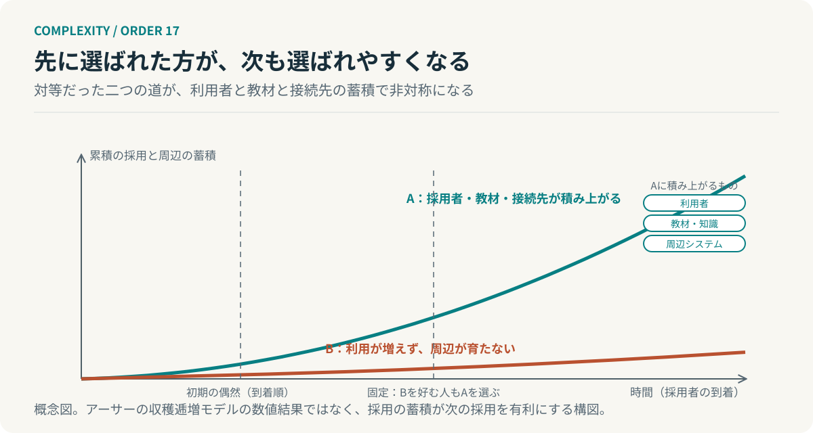

# 第17回　選ばれたから、選ばれ続ける

## ブライアン・アーサーの経路依存性とロックイン

<!-- NAV:TOP -->
[← 第16回](16-causal-emergence.md) | [連載目次](../README.md) | [第18回 →](18-robust-yet-fragile.md)
<!-- /NAV -->

最初は仮採用のツールだった。試しに一つのチームが使い、手順書ができ、別のチームが真似た。周辺の仕組みがそれに合わせて組まれ、新人向けの教材も整っていく。いつの間にか変更できない標準になっている。誰かが最良だと判定した記録はどこにもない。

ブライアン・アーサーは採用が進むほど有利になる技術の競争を数理的に扱った。[^arthur] 第Ⅰ部では見方を変えることを扱った。第Ⅱ部は成功した構造がなぜ変えにくくなるのかを読む。その最初の回として選択が時間を通じて蓄積する過程を見る。

### 選ばれるほど、選びやすくなる

二つの技術が採用者を奪い合うとき、ふつうは優れた方が残ると考える。アーサーが問題にしたのは採用そのものが技術の価値を押し上げる場合である。利用者が増えれば教材が増え、周辺の道具がそろい、困ったときに聞ける相手が増える。採用の数が次の採用者の利得に入る。これを収穫逓増と呼ぶ。[^arthur]

収穫逓増があると初期の採用順という偶然が長期の結果を決め得る。先に何人かが片方を選べば、その技術の利得が上がり、本来はもう片方を好んだ人まで同じ技術を選ぶ。アーサーはこの状況で三つを示した。やがてどちらか一方への固定が起こること、固定される側が効率的とは限らないこと、そしてどちらに固定されるかを事前に予測できないことである。[^arthur]

### 固定が起こる仕組みを、数で見る

簡略な説明用の模型を置く。採用者には二種類あり、R型は技術Aを、S型は技術Bを本来は好む。それぞれの利得は本来の好みに採用者数に比例する項を足したものとする。

$$
\pi_{\mathrm{S}}(A)=8+0.5\,n_A,\qquad \pi_{\mathrm{S}}(B)=10+0.5\,n_B.
$$

S型はBを好むが、Aの採用者数 $n_A$ がBの採用者数 $n_B$ を4人より多く上回れば、Aの利得がBを超える。到着順の偶然でAが先に5人の差をつければ、以後はS型もAを選び、差は開く一方になる。これは本連載の説明用の数値例であり、アーサーの原論文の表記を単純化したものである。

*図17：採用の蓄積が次の採用を有利にする構図。到着順の偶然で差がつき、固定の後はもう一方を好む人まで同じ道を選ぶ。アーサーのモデルの数値結果ではない。*

数が示すのは固定が誰かの判断を要しないことである。各自が自分の利得に従って選んだだけで全体は一方に寄る。最良だと判定した記録がどこにもないのは、判定が行われなかったからである。

### 蓄積するのは、関係である

第6回では相互依存の配置を扱った。どの結合を内部に残し、どの結合を抑えるかという、ある時点の設計である。今回はその配置が時間を通じてどう固まるかを見ている。教材、周辺の仕組み、運用の習慣、問い合わせの経路。それぞれが採用された技術に結びつき、技術を変えるとそのすべてを変えることになる。

変更の費用は技術そのものではなく、技術に結びついた関係の数で決まる。関係は使うほど増える。だから標準は、使われているというだけの理由で、使われ続ける。

### 選択は、次の選択肢を狭める

開発組織へ移すと採用の判断に一つの項目が加わる。この選択が、次にどの選択肢を閉じるか、である。仮採用のつもりでも、手順書と教材と周辺の仕組みが結びつけば固定が始まる。固定そのものを避けることはできないし避ける必要もない。固定する相手を選べるのは最初の数人のうちだけだ、ということを知っておけばよい。

AIエージェントの構成でも同じ構図が現れる。あるモデルや形式に合わせて書かれた指示書と評価用のデータが増えるほど、別のものへ移す費用は上がる。これはアーサーのモデルからの類推であって、エージェント構成の移行費用を測った結果ではない。

**選択は未来を開くと同時に、次の選択肢を狭める。**

仮採用のツールに戻る。最初に使った一つのチームは標準を決めたつもりはなかった。決めたのはその後に積み上がった手順書と教材と接続先である。いま変更できないのは、ツールが優れているからなのか。それとも、変更に要る手の数が増えたからなのか。

## 参考文献・注記

[^arthur]: W. Brian Arthur（1989）. [Competing Technologies, Increasing Returns, and Lock-In by Historical Events](https://ideas.repec.org/a/ecj/econjl/v99y1989i394p116-31.html)。The Economic Journal, 99(394), 116–131。収穫逓増のもとでの固定、非効率、予測不能性。原文は今回未取得で、要旨と二次資料で照合した。

<!-- NAV:BOTTOM -->
---

*次回　第18回「強くしたところが、弱さになる」。ある失敗に強くなることは、あらゆる失敗に強くなることなのか。*

[← 第16回](16-causal-emergence.md) | [連載目次](../README.md) | [第18回 →](18-robust-yet-fragile.md)
<!-- /NAV -->
