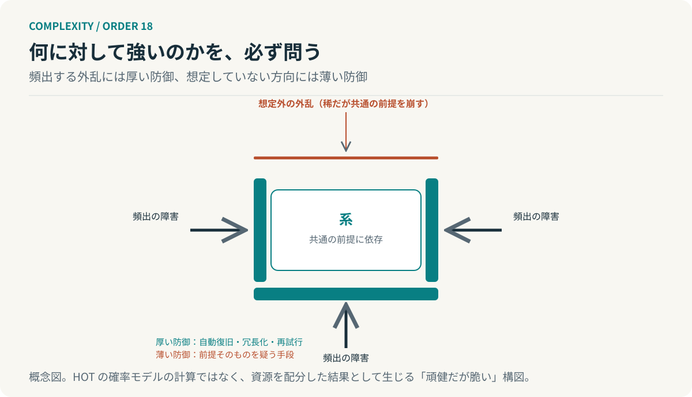

# 第18回　強くしたところが、弱さになる

## 高度に最適化された頑健性と、想定外への脆さ

<!-- NAV:TOP -->
[← 第17回](17-lock-in.md) | [連載目次](../README.md) | [第19回 →](19-resilience.md)
<!-- /NAV -->

通常の障害には自動で復旧する。サーバーが落ちれば立ち上げ直し、呼び出しが失敗すれば再試行し、負荷が増えれば台数を増やす。何年もそれで動いてきた。ところが全台が共通して参照している設定の配信が止まった日、復旧の仕組みごと全体が止まった。復旧の仕組みも同じ設定を参照していたのである。

カールソンとドイルは、こうした構造を高度最適化耐性、HOTと呼ぶ枠組みで扱った。[^carlson] 前回、選択が蓄積して固定する過程を見ている。今回はその固定が強さの形をとって現れる場合を見る。

### 頑健だが、脆い

HOTが対象にするのは、生物や工学の系のように、設計や進化によって高度に組織された系である。カールソンとドイルによれば、そうした系は内部が高度に構造化されている一方で、外部の挙動は頑健だが脆い。頻繁に起こる外乱には驚くほど強く、想定していなかった外乱には驚くほど弱い。[^carlson]

二つの性質は偶然並んでいるのではない。頻出の外乱へ資源を集中させた結果として資源が割かれなかった方向が残る。強さと脆さは同じ設計から生まれる。[^carlson]

### 資源を配分すれば、薄い場所ができる

説明用に簡略化すると設計とは限られた資源を外乱の種類ごとに配ることである。外乱 $i$ が起こる確率を $p_i$、そこに割く資源を $r_i$、資源に応じて減る損失を $\ell(r_i)$ とすれば、期待される損失を最小にする配分は次のように書ける。

$$
\min_{r}\ \sum_i p_i\,\ell(r_i)\qquad\text{s.t.}\quad \sum_i r_i\le R.
$$

確率の高い外乱ほど多くの資源を受け取り、確率の低い外乱には資源がほとんど回らない。この配分は期待損失の意味では正しい。だが稀な外乱が起きたとき、そこには防御がない。これは本連載の説明用の模型であり、HOTの文献が扱うべき乗則の導出を再現したものではない。[^carlson]

*図18：資源配分の結果として生じる「頑健だが脆い」構図。厚い防御は頻出の障害に向き、共通の前提を崩す稀な外乱には薄い。HOTの確率モデルの計算ではない。*

### 想定は、過去の選択である

何を頻出と見なすかは過去の障害の記録で決まる。記録にある障害へ対策を積み、記録にない障害は対策の対象にならない。前回の言葉で言えば想定は過去に選ばれた外乱の一覧であり、それが蓄積するほど一覧の外は見えなくなる。

冒頭の系で復旧の仕組みが設定配信に依存していたのは、設定配信が止まった記録がなかったからである。こうして止まらないものは前提になり、前提は対策の対象から外れる。共通の前提が崩れる障害は稀で、だからこそ防御が薄い。

### 強さを測るときに、相手を問う

開発組織へ移すと頑健性を評価するときの問いが一つ増える。何に対して強いのか、である。自動復旧の成功率は想定した障害に対する強さを測っている。想定の外にある障害に対してはその数字は何も語らない。

だから対策として考えられるのは、資源の一部を想定外の方向へ意図的に残すことである。たとえば共通の前提を一覧にし、それが崩れたときの振る舞いを試す。復旧の仕組みが依存するものを復旧の対象から分離する。手数はかかる。これらは期待損失の最小化からは出てこない設計で、頻度の低い方向に資源を置くという決定が要る。HOTからの工学的な示唆であり、カールソンとドイルの処方ではない。

AIエージェントの構成でも、評価データで頻出する失敗には強く、評価データにない失敗には弱い構造が生まれる。評価が整うほど評価の外は薄くなる。

**強さを評価するときは、何に対して強いのかを必ず問う。**

止まった日に戻る。何年も止まらなかった系が止まったのは弱かったからではない。頻出の障害に対して強くなり続けた結果、強さの向きが一つに揃っていたからである。次に揃う向きは、どこか。

## 参考文献・注記

[^carlson]: J. M. Carlson, John Doyle（2002）. [Complexity and robustness](https://pmc.ncbi.nlm.nih.gov/articles/PMC128573/)。PNAS, 99(suppl 1), 2538–2545。高度最適化耐性（HOT）と「頑健だが脆い」外部挙動。1999年の原モデルは未取得。

<!-- NAV:BOTTOM -->
---

*次回　第19回「元に戻ることと、生き残ることは違う」。元の状態へ素早く戻れるシステムは、本当に存続しやすいのか。*

[← 第17回](17-lock-in.md) | [連載目次](../README.md) | [第19回 →](19-resilience.md)
<!-- /NAV -->
