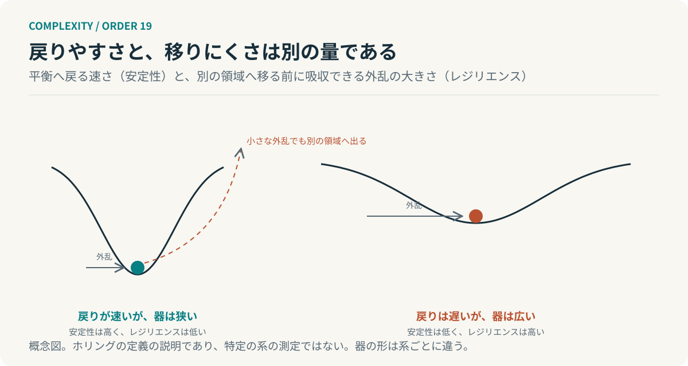

# 第19回　元に戻ることと、生き残ることは違う

## ホリングのレジリエンスと安定性

<!-- NAV:TOP -->
[← 第18回](18-robust-yet-fragile.md) | [連載目次](../README.md) | [第20回 →](20-panarchy.md)
<!-- /NAV -->

二つの組織を思い浮かべる。一方は障害のたびに元の手順へ復旧する。復旧は速く、翌日には何事もなかったように同じ手順で動いている。もう一方は障害のたびに手順を少し変える。復旧は遅く、同じ状態には二度と戻らない。それでも利用者へ届く機能は保たれている。どちらが存続しやすいのか。

ホリングは生態系の研究でこの二つを別の性質として分けた。[^holling1973] 前回は強さの向きを問うた。今回、戻ることと続くことを分ける。

### 安定性と、レジリエンス

ホリングが1973年に区別したのは安定性とレジリエンスである。安定性は、外乱の後に系が平衡へ戻る性質で、戻る速さと揺れの小ささで測る。レジリエンスは、系が変化を吸収しながら関係を保ち続ける性質で、別の状態領域へ移ってしまう前にどれだけの外乱を吸収できるかで測る。[^holling1973]

後にホリングはこれを工学的レジリエンスと生態学的レジリエンスという対比でも述べた。前者は一つの平衡の近くで戻りの速さを問う。後者は複数の安定な領域があることを前提に、いまの領域に留まれる外乱の大きさを問う。[^holling1996]

二つは同じ量ではない。戻りが速い系が、大きな外乱で別の領域へ移ってしまうことがある。戻りが遅く揺れの大きい系が、関係を保ったまま大きな外乱を吸収することもある。

*図19：安定性とレジリエンスの概念図。左は戻りが速いが器が狭く、右は戻りが遅いが器が広い。ホリングの定義の説明であり、特定の系の測定ではない。*

### 二つの組織を、二つの量で読む

冒頭の二つの組織をこの区別で読み直す。元の手順へ速く復旧する組織は安定性が高い。だが手順を変えないということは、いまの手順で吸収できない外乱が来たとき、吸収する手段がないということでもある。器は深いが狭い。

手順を変えながら機能を保つ組織は安定性では劣る。同じ状態には戻らないし、戻りも遅い。その代わり外乱のたびに関係を組み替えて吸収している。器は浅いが広い。ホリングの区別で言えばこちらはレジリエンスが高い。

どちらが存続しやすいかは来る外乱の大きさによる。想定の内側に留まる外乱なら前者で足りる。想定を超える外乱が来るなら、残るのは後者だけである。前回のHOTの言葉では前者は想定した外乱に最適化された系である。

### 何を元に戻すかより、何を続けたいか

第5回で自己維持とは構成要素を入れ替えながら組織を保つことだと述べた。頑丈であることと、作り直し続けることは違う。今回の区別はその続きにある。元の状態を保つことと、関係を保つことは違う。

復旧の目標を「元の手順」に置くと安定性を上げる投資が選ばれる。復旧の目標を「利用者へ届く機能」に置くと、手順を変えてでも機能を保つ投資が選ばれる。どちらの目標を置くかは何を存続させたいかの決定である。

### 回復力という一語に、まとめない

開発組織ではこの二つが「回復力」という一語にまとめられやすい。障害からの復旧時間は安定性の指標であり、それだけを追うと、手順を変えて機能を保つ能力は測られない。別の指標が要る。想定外の障害で機能が保たれた回数、手順を変えて吸収した障害の数、といった量である。

AIエージェントの運用でも同じで、失敗からの再実行が速いことと、失敗の種類が変わったときに手順を組み替えられることは別の能力である。これはホリングの定義からの類推であり、組織やエージェントのレジリエンスを測った結果ではない。

**何を元に戻すかより先に、何を存続させたいのかを決める。**

二つの組織に戻る。速く戻る方は昨日と同じ姿で今日も動いている。遅く戻る方は昨日とは少し違う姿で動いている。同じ姿を保つことと、動き続けることのどちらを守っていたのか。それは次の外乱が来るまで分からない。

## 参考文献・注記

[^holling1973]: C. S. Holling（1973）. [Resilience and Stability of Ecological Systems](https://pure.iiasa.ac.at/id/eprint/26/7/RP-73-003.pdf)。Annual Review of Ecology and Systematics, 4, 1–23。安定性とレジリエンスの区別。

[^holling1996]: C. S. Holling（1996）. [Engineering Resilience versus Ecological Resilience](https://nap.nationalacademies.org/read/4919/chapter/4)。In P. C. Schulze (ed.), Engineering Within Ecological Constraints, National Academies Press。工学的レジリエンスと生態学的レジリエンス。

<!-- NAV:BOTTOM -->
---

*次回　第20回「崩れるときにも、残っているものがある」。ある階層の崩壊が全体の終わりになる場合と、再編成につながる場合は、何が違うのか。*

[← 第18回](18-robust-yet-fragile.md) | [連載目次](../README.md) | [第20回 →](20-panarchy.md)
<!-- /NAV -->
