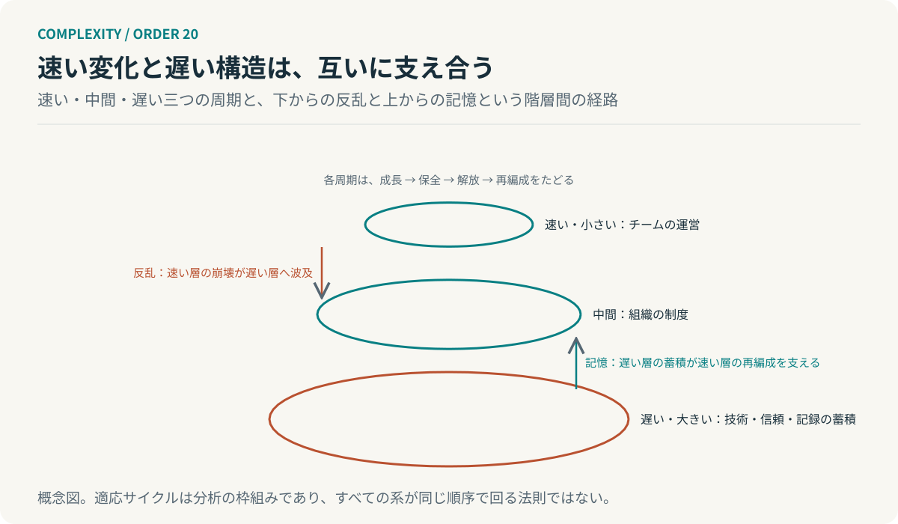

# 第20回　崩れるときにも、残っているものがある

## パナーキーと、異なる時間スケールの相互作用

<!-- NAV:TOP -->
[← 第19回](19-resilience.md) | [連載目次](../README.md) | [第21回 →](21-exploration-exploitation.md)
<!-- /NAV -->

チームの運営方法は一度崩れた。担当が入れ替わり、会議の形も進め方も変わる。それでも次のチームはゼロからは始まらなかった。蓄積された技術と残っていた信頼と書かれていた記録が、新しい運営を支えたのである。崩れたものと残ったものは別の層にあった。

ホリングとガンダーソンらは、速さの違う階層が互いに結びついた構造をパナーキーと呼んだ。[^holling2001] [^panarchy] 前回は戻ることと続くことを分けた。今回、崩壊が終わりになる場合と再編成になる場合を分ける。

### 成長し、保全し、解放し、再編成する

パナーキーの基礎にあるのは適応サイクルである。一つの系は四つの段階をたどると記述される。資源を集めて成長する段階、構造が固まり効率が上がる保全の段階、固まった構造が崩れる解放の段階、そして残ったものから組み直される再編成の段階である。[^holling2001]

ここまでの三回はこのうち保全から解放への道筋を別々の角度から見てきた。選択が蓄積して固定し、強さの向きが揃い、元へ戻す力だけが高まる。保全の段階が進むほど、系は効率的になり、同時に変化に対して硬くなる。

ただし適応サイクルはすべての系が同じ順序で回る法則ではない。ホリングらも分析の枠組みとして提示している。本連載でも、観察を整理する型として使い、予測の式としては使わない。[^holling2001]

### 速い層と遅い層が、結びつく

パナーキーが適応サイクルに加えるのは階層間の結びつきである。小さく速い層は短い周期で回り、大きく遅い層は長い周期で回る。チームの運営は速く、組織の制度は中間で、技術や信頼や記録の蓄積は遅い。[^holling2001]

層の間には二つの経路がある。一つは下からの経路で、速い層の崩壊が上の層へ波及する。パナーキーの文献はこれを反乱と呼ぶ。もう一つは上からの経路で、遅い層に保持された蓄積が、下の層の再編成を支える。こちらは記憶と呼ばれる。[^panarchy]

*図20：パナーキーの概念図。各層は適応サイクルをたどり、速い層の崩壊は上へ波及し、遅い層の蓄積は再編成を支える。分析の枠組みであり、すべての系がこの順序で回る法則ではない。*

### 崩壊が、終わりにならない条件

冒頭の再編をこの二つの経路で読む。チームの運営という速い層は解放の段階に入り、崩れた。その崩壊は組織の制度まで波及しなかった。一方で技術と信頼と記録という遅い層は保全の段階にあって崩れていない。再編成はその蓄積を使って始まる。つまり記憶の経路が働いたのである。

同じ崩壊が終わりになるのは遅い層まで一緒に崩れるときである。記録が残っておらず信頼が失われ、技術が人と共に去れば再編成の材料がない。反乱が上まで波及し、記憶が働かない。崩壊の大きさではなく、層の分離が結果を分ける。

### 残すものと、手放すもの

第Ⅰ部では見方を変えることを扱い、第Ⅱ部ではここまで、構造が硬直する過程を扱ってきた。パナーキーはその先を示す。構造を変えるとは、速い層を手放すことと、遅い層を残すことを同時に行うことである。

開発組織へ移すと崩してよいものと崩してはならないものの一覧が要る。運営方法や会議の形は速い層で変えてよい。設計の記録とテストの資産と利用者との信頼と人の中にある技術は遅い層で、再編成の材料になる。再編のたびに後者まで失えば毎回ゼロから始めることになる。

AIエージェントの構成でも、指示書や手順は速く変えてよいが、評価用のデータと過去の判断の記録は遅い層にあたる。これはパナーキーからの類推であり、組織やエージェントの階層を測った結果ではない。

**変化を支えるために残すものと、変化のために手放すものがある。**

再編の日に戻る。会議室の顔ぶれは変わり、進め方も変わった。変わらなかったのは棚にある設計書と動いているテストと、前のチームが残した信頼である。次に崩れるとき、何が棚に残っているか。

## 参考文献・注記

[^holling2001]: C. S. Holling（2001）. [Understanding the Complexity of Economic, Ecological, and Social Systems](https://link.springer.com/article/10.1007/s10021-001-0101-5)。Ecosystems, 4, 390–405。適応サイクルとパナーキー。要旨を確認、本文全文は未取得。

[^panarchy]: Lance H. Gunderson, C. S. Holling (eds.)（2002）. [Panarchy: Understanding Transformations in Human and Natural Systems](https://press.princeton.edu/isbn/9781597269391)。Island Press。階層間の「反乱」と「記憶」。書誌と紹介のみ確認。

<!-- NAV:BOTTOM -->
---

*次回　第21回「上手になるほど、試せなくなる」。既存の方法を改善し続けることが、なぜ将来への適応を難しくするのか。*

[← 第19回](19-resilience.md) | [連載目次](../README.md) | [第21回 →](21-exploration-exploitation.md)
<!-- /NAV -->
