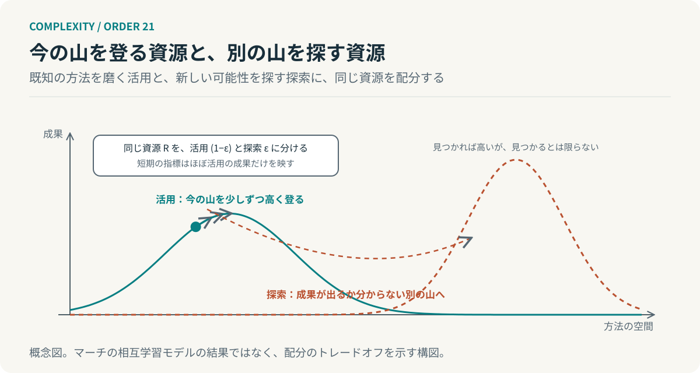

# 第21回　上手になるほど、試せなくなる

## マーチの探索と活用、そして学習の配分

<!-- NAV:TOP -->
[← 第20回](20-panarchy.md) | [連載目次](../README.md) | [第22回 →](22-commons.md)
<!-- /NAV -->

成果が確実な改善だけを採用してきた。どの改善も効いた。指標は毎期上がり、失敗はほとんどない。ところが気づくと新しい方法を試す時間が予定表のどこにも残っていない。こうして試すための枠は確実な改善に少しずつ食われていた。

ジェームズ・マーチは組織の学習をこの二つの活動の配分として論じた。[^march] 第Ⅱ部では秩序が硬直する過程を読んだ。第Ⅲ部では、新しい可能性を試行で終わらせず引き継ぐために何が要るかを考える。その最初の回として、試す余地がなぜ消えるのかを見る。

### 探索と、活用

マーチが探索と呼ぶのは探し、試し、変化させて発見する活動である。活用と呼ぶのは既知の方法を洗練し、選んで効率よく実行する活動である。ただしどちらも学習でありながら、成果の現れ方が違う。活用の成果は近くて確実で、探索の成果は遠くて不確実である。[^march]

マーチの議論の核心はこの違いが配分を偏らせる点にある。つまり適応的な過程は成果が近い方を速く洗練する。活用は試すたびに上手になり、上手になるほど選ばれる。一方で探索は試しても多くは失敗し、失敗するほど選ばれなくなる。だから学習する組織は放っておくと活用へ寄り、短期には有効で長期には自壊的になり得る。[^march]

### 配分の偏りを、式で見る

説明用の簡略な模型を置く。資源を $R$ とし、割合 $\varepsilon$ を探索に、残りを活用に充てる。活用は一期あたり確実な成果 $g$ を生む。探索は確率 $q$ で大きな成果 $G$ を生むが、それが現れるのは $T$ 期後である。一期あたりの価値を割引率 $\delta$ で現在に引き直すと、次のように書ける。

$$
V_T(\varepsilon)=(1-\varepsilon)\,g+\delta^{T}\,\varepsilon\,q\,G.
$$

$T$ が大きいほど第二項は小さく見える。今期の指標は第一項しか映さない。指標を見て配分を決めれば $\varepsilon$ は毎期小さくなる。これは本連載の説明用の模型であり、マーチの相互学習モデルではない。マーチのモデルでは組織の規範と個人の信念が互いに学び合い、学習の速い個人ばかりになると規範に多様性が残らなくなるという別の経路で、同じ偏りが示される。[^march]

*図21：配分のトレードオフの概念図。活用は今の山を少しずつ高く登り、探索は見つかるとは限らない別の山へ向かう。マーチのモデルの結果ではない。*

### 上手になるほど、試せなくなる

冒頭の予定表に戻ると起きていたのはこの偏りである。確実な改善は毎回成果を出し、成果が出るたびに次も確実な改善が選ばれた。誰も探索を禁じていない。探索が負け続けただけである。

第8回で行動の前に何を知るべきかを選ぶことを扱った。あれは一回の判断の話だった。今回、組織が長い時間をかけて何を学ぶかという配分の話をしている。一回ごとの判断が合理的でも積み重なると学習の幅が狭まる。前回の言葉で言えば、保全の段階が進むのと同じ構図が、学習の配分にも現れる。

### 今日の効率で測らない領域

対策は探索を今日の効率で評価しないことに尽きる。探索の枠を指標の外に置き、成果が出なくても枠を減らさない。枠の大きさは事前に決め、結果で変えない。これは経済合理性に反して見えるが、式の第二項が現れるまで待つという決定である。

開発組織では確実な改善と同じ会議で探索の採否を決めない方がよい。同じ会議に出せば必ず確実な方が勝つ。別の枠、別の評価、別の時間軸を用意する。AIエージェントの改善でも、評価指標で勝った変更だけを採用し続ければ、指標の外にある方法は試されない。指標の外を試す枠を残すかどうかは指標の改善からは導かれない。これはマーチの議論からの類推であって、エージェントの学習を測った結果ではない。

**探索を残すには、今日の効率だけでは評価しない領域が要る。**

予定表に戻る。空いている枠は一つもない。埋めたのは失敗ではなく、成功だった。次の期に一枠を空けるとして、その枠が成果を出さなかったとき、誰がそれを守るのか。

## 参考文献・注記

[^march]: James G. March（1991）. [Exploration and Exploitation in Organizational Learning](https://ideas.repec.org/a/inm/ororsc/v2y1991i1p71-87.html)。Organization Science, 2(1), 71–87。探索と活用の区別、適応過程の偏り、相互学習モデル。原文は今回未取得で、要旨と二次資料で照合した。

<!-- NAV:BOTTOM -->
---

*次回　第22回「みんなのものを、誰が守るのか」。複数の自律した主体は、共有資源の利用と維持をどう両立するのか。*

[← 第20回](20-panarchy.md) | [連載目次](../README.md) | [第22回 →](22-commons.md)
<!-- /NAV -->
