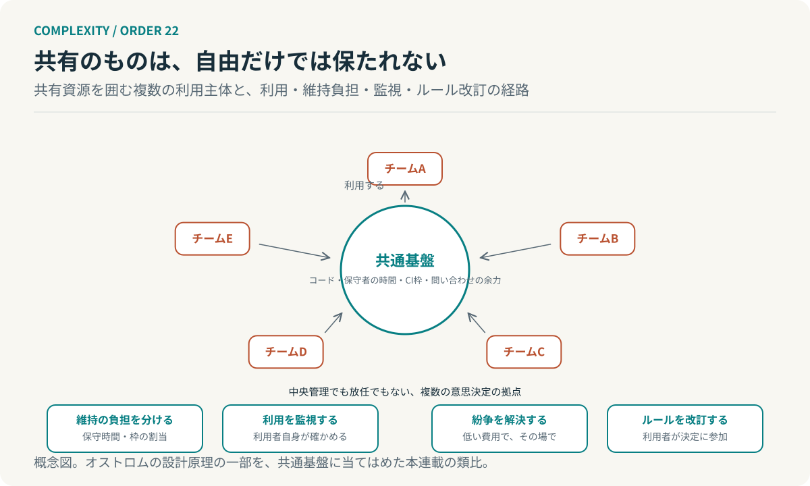

# 第22回　みんなのものを、誰が守るのか

## オストロムの多中心型ガバナンスとコモンズ

<!-- NAV:TOP -->
[← 第21回](21-exploration-exploitation.md) | [連載目次](../README.md) | [第23回 →](23-major-transitions.md)
<!-- /NAV -->

五つのチームが同じ共通基盤を使っている。基盤のコードは一つである。ただし保守している人は数人しかいない。共有の実行枠は混み合い、問い合わせは特定の人に集まる。どのチームも基盤を使いたい。だが保守の時間を出すチームはない。使う自由はあり、守る責任は誰のものでもない。

エリノア・オストロムは、共有資源をめぐるこの問題を、中央の管理でも市場の私有化でもない第三の道として研究した。[^ostrom] 前回、探索の枠を守ることを扱った。今回、複数の自律した主体が共有するものを守る仕組みを扱う。

### 中央か、放任か、ではない

共有資源の問題には定番の答えが二つある。すなわち、中央が管理して利用を割り当てるか、分割して各自の所有にするかである。オストロムが示したのは、現実の共有資源の多くがそのどちらでもない制度で長く維持されてきたことだった。利用者自身が規則をつくって互いに監視し、違反を段階的に制裁し、紛争をその場で解決する制度である。[^ostrom]

オストロムはこうした制度を複数の意思決定の拠点が重なり合う多中心型の統治として捉えた。そこでは一つの中心がすべてを決めるのではなく、資源に近い場所で決められることを決め、より広い範囲に関わることは上位で扱う。[^ostrom]

### 持続する制度に、共通するもの

オストロムが長年の事例研究から取り出した設計原理には次のものが含まれる。[^ostrom]

- 誰が利用者かの境界が明確である
- 規則が地域の条件に合っている
- 規則の影響を受ける人が、その改訂に参加できる
- 監視を利用者自身か、利用者に責任を負う者が行う
- 違反への制裁が段階的である
- 紛争を低い費用で解決する場がある
- より大きな系の中では、これらの仕組みが入れ子になっている

*図22：共通基盤を共有資源として見た概念図。利用の自由だけでなく、維持の負担と監視と紛争解決と規則の改訂が、利用者自身の参加で回る。オストロムの設計原理の一部を当てはめた本連載の類比である。*

原理は処方箋ではない。オストロム自身、制度は場所ごとに違い、外から一つの型を持ち込んでも機能しないと繰り返している。共通するのは利用者が規則の作成と監視に参加していることである。

### 共通基盤を、共有資源として見る

冒頭の共通基盤をこの目で見直す。資源はコードだけではない。保守者の時間と共有の実行枠と問い合わせに答える余力も、使えば減る共有資源である。五つのチームはこれを使う自由を持つが維持の負担は配分されていない。放任の状態である。

中央で管理する案は基盤チームをつくって割り当てを決めることになる。だが基盤チームは五つのチームの個別の事情を知らず、割り当ては実態からずれ、問い合わせは結局またしても基盤チームに集まることになる。もう一つの道は利用者が維持に参加する制度を設計することである。保守時間を各チームが出し合う。実行枠の使い方を利用者同士で監視する。規則の改訂に利用するチームが参加する。衝突はその場で解決する場を持つ。

### 自律性には、負担の設計が要る

第10回のVSMは一つの組織の内部で機能をどう配置するかを扱った。だが今回の主体は互いに独立していて、上位の指揮系統を持たない。独立した主体のあいだで共有を続けるには、自由に加えて、負担と規則を共同で設計する手続きが要る。

AIエージェントを複数動かす構成でも、共有の実行枠や共通の道具は同じ性質を持つ。各エージェントに自由に使わせれば混み合い、中央で厳しく割り当てれば実態とずれる。構図は同じである。利用の記録を互いに見える形にし、割り当ての規則を使う側が改訂できるようにする。これはオストロムの研究からの類推であり、エージェント群の統治を検証した結果ではない。

**自律性の持続には、自由だけでなく、負担とルールの共同設計が必要である。**

五つのチームに戻る。基盤はまだ動いている。保守している数人がまだ辞めていないからである。その数人の時間を誰が出しているのか。誰も出していないとすれば、基盤は共有されていたのではなく、ただ使われていただけである。

## 参考文献・注記

[^ostrom]: Elinor Ostrom（2010）. [Beyond Markets and States: Polycentric Governance of Complex Economic Systems](https://www.aeaweb.org/articles?id=10.1257/aer.100.3.641)。American Economic Review, 100(3), 641–672。ノーベル賞記念講演。多中心型の統治と、持続する自治制度の設計原理。原文は今回未取得で、要旨と二次資料で照合した。

<!-- NAV:BOTTOM -->
---

*次回　第23回「集まることと、一つになることは違う」。協働する要素の集まりは、いつ新しい全体として存続・継承されるようになるのか。*

[← 第21回](21-exploration-exploitation.md) | [連載目次](../README.md) | [第23回 →](23-major-transitions.md)
<!-- /NAV -->
