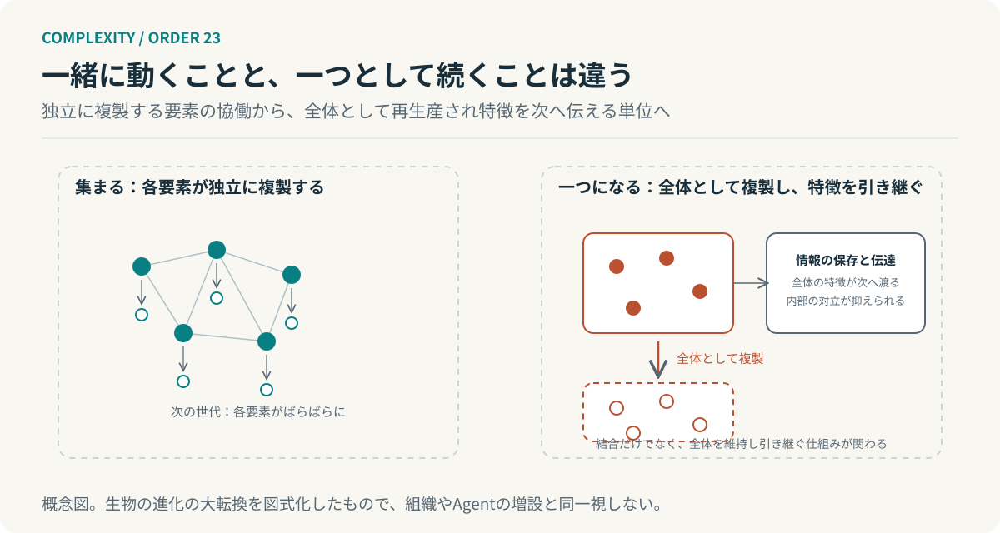

# 第23回　集まることと、一つになることは違う

## 進化の大転換と、新しい単位の成立

<!-- NAV:TOP -->
[← 第22回](22-commons.md) | [連載目次](../README.md) | 第24回（準備中）
<!-- /NAV -->

この連載は「まとまり」という語を何度も使ってきた。局所的なまとまりを一つの単位として扱えれば階層ができる、と第1クールで述べた。だがそこで問わなかったことがある。一緒に動いている要素の集まりはいつから一つの単位なのか。集まっていることと、一つであることは同じではない。

メイナード＝スミスとサトマーリは、生物の進化の中で新しい単位が成立した出来事を、大転換として整理した。[^maynardsmith] 前回は独立した主体が共有を続ける制度を扱った。今回、独立した要素が全体として続く単位になる条件を扱う。

### 転換の前と、後

大転換の特徴として挙げられるのは、転換の前には独立に複製できた単位が、転換の後には全体の一部としてしか複製できなくなることである。単細胞から多細胞へ、独立した遺伝子から染色体へ、といった出来事がこれにあたる。複製の単位が一段上がる。[^maynardsmith]

もう一つ、情報の保存と伝達の仕方が変わるという特徴がある。転換は新しい情報の担い手や伝え方を伴い、全体の特徴が次の世代へ渡る経路ができる。サトマーリは後にこの二つ、個体性の転換と情報システムの進化を、理論の二つの軸として整理し直した。[^szathmary2015]

### 一緒に動くだけでは、足りない

協働している要素の集まりがそれだけで新しい単位になるわけではない。大転換の議論では三つが単位の成立に関わるとされる。分業が生じること、全体の内部で要素同士の対立が小さく保たれること、そして全体として複製され特徴が引き継がれることである。[^maynardsmith] 内部の対立を積極的に抑える機構がどれほど重要だったかについては、後の再検討で、多くの転換では役割が小さかったという指摘もある。[^west2015]

*図23：大転換の概念図。左は各要素が独立に複製する協働、右は全体として複製し特徴を引き継ぐ単位。生物の進化を図式化したもので、組織やAgentの増設と同一視しない。*

本連載が借りるのは一点である。新しい階層の成立には結合だけでなく、その全体を維持して次へ引き継ぐ仕組みが関わる。一方で結合は一時的な協働で足りるが、単位として続くには全体の特徴を保存し伝える経路が要る。

### 第1クールの語を、時間の中で読み直す

第5回の自己生産は構成要素を入れ替えながら組織を保つことだった。第6回の自己触媒集合は互いの生成を支える構造が成立する条件だった。そして第1回の階層は部分ごとに扱える構造を指す。いずれもある時点で全体が成り立つ条件を扱っている。

大転換の視点はそこに時間を加える。全体が成り立つだけでなく、次の時点にも同じ全体として続き、特徴を引き継ぐかを問う。前回までの言葉で言えば、第20回の記憶の経路が、単位の内部に組み込まれているかどうかである。

### 組織や機械へ、どこまで移せるか

ここから先は類推であり、生物学の結論ではない。開発チームを統合して一つの組織にしても、各チームが独立に評価され独立に存続するなら、複製の単位は上がっていない。一つの単位になったと言えるのは、全体として評価され、全体の知識や規範が次の構成員へ引き継がれる経路を持ったときである。

AIエージェントを増設して協働させる場合も同じで、台数が増えることと、全体として一つの単位が成立することは別である。全体の判断の記録と評価の基準が引き継がれなければ増設は協働のままで終わる。生物の進化を組織再編やエージェントの増設と同一視しないという留保を、ここでは第5回より厚く置く。生物の転換は選択の過程で生じたが、組織や機械の単位は設計の決定で生じるからである。

**新しい階層の成立には、結合だけでなく、その全体を維持して引き継ぐ仕組みが関わる。**

「まとまり」という語に戻る。第1クールではまとまりができれば階層ができると書いた。できたまとまりが明日も同じまとまりであるとはそこでは言っていなかった。次へ渡しているものは、何か。

## 参考文献・注記

[^maynardsmith]: John Maynard Smith, Eörs Szathmáry（1995）. [The Major Transitions in Evolution](https://global.oup.com/academic/product/the-major-transitions-in-evolution-9780198502944)。Oxford University Press。複製の単位の変化、情報の保存と伝達、分業。原文は今回未取得で、二次資料と szathmary2015 の要旨で照合した。

[^szathmary2015]: Eörs Szathmáry（2015）. [Toward major evolutionary transitions theory 2.0](https://pmc.ncbi.nlm.nih.gov/articles/PMC4547294/)。PNAS, 112(33), 10104–10111。個体性の転換と情報システムの進化という二つの軸。

[^west2015]: Stuart A. West, Roberta M. Fisher, Andy Gardner, E. Toby Kiers（2015）. [Major evolutionary transitions in individuality](https://doi.org/10.1073/pnas.1421402112)。PNAS, 112(33), 10112–10119。競争を抑える機構の役割は多くの転換で小さかったとする再検討。要旨のみ確認。

<!-- NAV:BOTTOM -->
---

*次回　最終回「同じであり続けるために、変わっていく」。システムが存続するとは、何が残ることなのか。*

[← 第22回](22-commons.md) | [連載目次](../README.md) | 第24回（準備中）
<!-- /NAV -->
