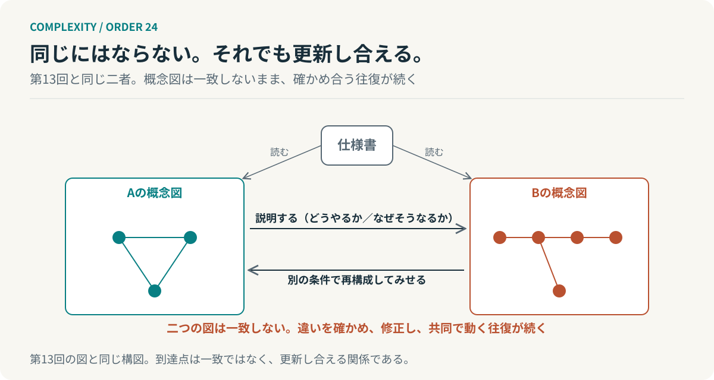
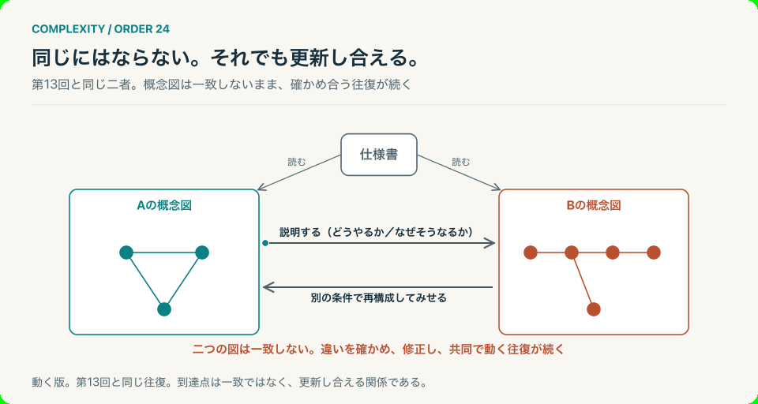

# 第24回　同じであり続けるために、変わっていく

## 秩序の維持から、秩序の更新へ

<!-- NAV:TOP -->
[← 第23回](23-major-transitions.md) | [連載目次](../README.md) | 第2クール最終回
<!-- /NAV -->

### 同じ文書から、違う図を描いた二人

第13回に同じ仕様書を読んで別々の概念図を描いた二人がいた。読み合わせでは全員が頷き、できあがったものは違っていた。二人は説明を交わして別の条件で再構成してみせ、同じ語の下に別の構造があったことを見つける。

この二人に最終回でもう一度登場してもらう。第13回から第23回までの道のりを歩いたあと、二人の図はどうなったか。先に答えを言えば一致していない。それでも二人はまだ一緒に仕事をしている。

第1クールは「どれほどの複雑さを、私たちは成立させることができるのか」という問いで閉じた。そして第2クールはその問いを裏返した。成立した秩序が次の変化を妨げるものになったとき、どうすればよいのか。十一の回をたどり直すと、答えはいくつかの動詞の形をとる。

### 理解を確かめるために、説明を変える

パスクの会話理論は理解を頭の中の状態ではなく、二者のあいだで確かめられる手続きとして扱った。復唱は語が届いたことを確かめ、再構成の実演は理解が成立したことを確かめる。[^pask] 共有するものは文書だけではなく理解の違いを発見する手続きもそうである、というのが第13回の到達点だった。

そしてベイトソンの学習階層はその手続きを一段上から見た。与えられた選択肢の中で答えを直す学習と、選択肢の組み立て方を変える学習は別の水準にある。[^bateson] 改善を続ける能力と、改善の前提を疑う能力は別の能力である。確認項目を増やすだけでは届かない場所がある。

二つの回を合わせると最初の動詞が見えてくる。理解を確かめるために、説明を変える。自分の説明を相手の再構成に合わせて組み替え、ときには説明の前提そのものを組み替える。説明が固定されたままでは理解の違いは見つからない。

### 判断するために、情報を省く

情報ボトルネック法は入力の情報量を抑えながら目的についての情報を保つ圧縮を、一つの最適化として書いた。[^tishby] つまりよい要約とは短い要約ではなく、目的に必要な区別を残した要約である。何を判断したいかが決まらなければ残す区別も決まらない。

一方でホーエルらの因果創発はその区別をどの粒度で残すかを問うた。微視的な記述が常に多くを語るとは限らず、一定のモデルでは粗い記述の方が原因をよく語る。[^hoel] だから階層は複雑さを管理するためだけでなく、原因を見つけるためにも選ばれる。

二つ目の動詞は、判断するために情報を省く、である。省くことは失うことではない。目的に照らして残す区別と単位を決めることである。第1クールで階層は複雑さを扱うための構造だと述べた。第Ⅰ部はその階層を理解と説明のための選択として読み直した。

### 成功した方法を、疑う

第Ⅱ部では、成功した構造がなぜ変えにくくなるのかを読んだ。アーサーの収穫逓増は採用の蓄積が次の採用を有利にし、初期の偶然が長期の選択を固定することを示した。[^arthur] 選択は未来を開くと同時に次の選択肢を狭める。

カールソンとドイルの高度最適化耐性は、頻出の外乱へ資源を集中させた系が想定外の外乱には薄い防御しか持たないことを示した。[^carlson] 強さと脆さは同じ設計から生まれる。強さを評価するときは何に対して強いのかを問う。

ホリングは平衡へ素早く戻る安定性と、変化を吸収しながら関係を保つレジリエンスを分けた。[^holling1973] 元の状態を保つことと、関係を保つことは違う。何を元に戻すかより先に何を存続させたいのかを決める。

三つ目の動詞は、成功した方法を疑う、である。固定も強さの向きも戻る力も、すべて成功の結果として生じる。疑うべきなのは失敗ではなく成功であり、その成功が何を閉じたかを見る目である。

### 全体を続けるために、部分を変える

パナーキーは速い層と遅い層が結びついた構造を描き、速い層の崩壊が上へ波及する経路と、遅い層の蓄積が再編成を支える経路の二つを置いた。[^holling2001] 変化を支えるために残すものと、変化のために手放すものがある。崩れたものと残ったものが別の層にあるとき崩壊は終わりにならない。

一方でマーチの探索と活用は学習の配分がなぜ活用へ偏るかを示した。[^march] 探索を残すには今日の効率だけでは評価しない領域が要る。それは静かに進む。ただし偏りは誰の悪意でもなく、一回ごとの合理的な判断の積み重ねから生じる。

四つ目の動詞は、全体を続けるために部分を変える、である。層を分けるのである。手順や会議の形や今日の方法は速い層にあって変えてよい。記録と信頼と技術は遅い層にあって残す。探索の枠も遅い層に置き、短期の指標で削らない。

### 引き継がなければ、学習は蓄積しない

ここまでの動詞はどれも変えることに向いている。だが変えるだけでは何も残らない。オストロムは共有資源を守る制度が利用者自身の参加によって続くことを示した。[^ostrom] 自律性の持続には、自由だけでなく、負担と規則の共同設計が要る。

メイナード＝スミスとサトマーリの大転換は、協働する要素の集まりが新しい単位になる条件を複製と情報の伝達に見た。[^maynardsmith] 新しい階層の成立には、結合だけでなく、全体を維持して引き継ぐ仕組みが関わる。一緒に動くことと、一つとして続くことは違う。

五つ目の動詞は、引き継ぐ、である。理解を確かめて情報を省き、成功を疑って部分を変える。そのあとに学習を次へ渡す経路がなければ、同じことを毎回ゼロから始めることになる。第20回の記憶の経路は単位の内部に組み込まれて初めて働く。

### 同じであり続けるために、変わっていく

*図24：第13回と同じ構図。二つの概念図は最後まで一致しない。違いを確かめ、修正し、共同で動く往復が続いている。*

*図24-動：第13回と同じ動き。往復は続き、二つの図は一致しない。*

五つの動詞を並べると一つのことが見えてくる。守るべきものは現在の形だけではない。形を変えながら必要な機能と関係を引き継げることである。

第1クールの中心命題は「複雑さが秩序を生み、秩序が次の複雑さを可能にする」だった。一方で第2クールはそこに一つを加える。成立した秩序は可能性を開くと同時に閉じる。だから秩序を維持する能力だけでなく、何を残し何を変えるかを決め直す能力が要る。つまり第1クールが「複雑さを成立させる」なら、第2クールは「成立の仕方を変えられるようにする」である。

**守るべきものは、現在の形だけではない。形を変えながら、必要な機能と関係を引き継げることである。**

たとえばこの連載が「階層」と呼んできたものも同じ扱いを受ける。階層は複雑さを扱うための解決策であり、同時に固定したときには問い直す対象になる。そして解決策として置いた境界がいつの間にか想定の境界になり、見えない場所を決めている。それに気づく手続きを持っているかどうかが秩序を更新できるかどうかを分ける。

二人に戻る。十一の回を経ても二人の概念図は一致していない。一致させることが目的ではなかったからである。それでも二人は違いを確かめる手続きを持ち、説明を組み替えて何を残し何を変えるかを決め直しながら、一つの仕事を続けている。同じになることではなく、違いがあっても更新し合える関係がそこにある。

仕様書はまだ一枚のままである。その上に描かれた二枚の図は、今日も少しずつ描き直されている。

## 参考文献・注記

[^pask]: Gordon Pask（1976）. [Conversation Theory: Applications in Education and Epistemology](https://monoskop.org/log/?p=2376)。Elsevier。リンク先は書誌と紹介。理解を再構成の実演として確かめる「教え返し」と、二つの水準の会話。原文は今回未取得。

[^bateson]: Gregory Bateson（1972）. [Steps to an Ecology of Mind](https://press.uchicago.edu/ucp/books/book/chicago/S/bo3620295.html)。Chandler / University of Chicago Press。所収の "The Logical Categories of Learning and Communication"（1964）。原文は今回未取得。

[^tishby]: Naftali Tishby, Fernando C. Pereira, William Bialek（1999）. [The information bottleneck method](https://arxiv.org/abs/physics/0004057)。37th Allerton Conference。arXiv:physics/0004057。

[^hoel]: Erik P. Hoel, Larissa Albantakis, Giulio Tononi（2013）. [Quantifying causal emergence shows that macro can beat micro](https://pmc.ncbi.nlm.nih.gov/articles/PMC3856819/)。PNAS, 110(49), 19790–19795。

[^arthur]: W. Brian Arthur（1989）. [Competing Technologies, Increasing Returns, and Lock-In by Historical Events](https://ideas.repec.org/a/ecj/econjl/v99y1989i394p116-31.html)。The Economic Journal, 99(394), 116–131。原文は今回未取得。

[^carlson]: J. M. Carlson, John Doyle（2002）. [Complexity and robustness](https://pmc.ncbi.nlm.nih.gov/articles/PMC128573/)。PNAS, 99(suppl 1), 2538–2545。

[^holling1973]: C. S. Holling（1973）. [Resilience and Stability of Ecological Systems](https://pure.iiasa.ac.at/id/eprint/26/7/RP-73-003.pdf)。Annual Review of Ecology and Systematics, 4, 1–23。

[^holling2001]: C. S. Holling（2001）. [Understanding the Complexity of Economic, Ecological, and Social Systems](https://link.springer.com/article/10.1007/s10021-001-0101-5)。Ecosystems, 4, 390–405。要旨を確認。

[^march]: James G. March（1991）. [Exploration and Exploitation in Organizational Learning](https://ideas.repec.org/a/inm/ororsc/v2y1991i1p71-87.html)。Organization Science, 2(1), 71–87。原文は今回未取得。

[^ostrom]: Elinor Ostrom（2010）. [Beyond Markets and States: Polycentric Governance of Complex Economic Systems](https://www.aeaweb.org/articles?id=10.1257/aer.100.3.641)。American Economic Review, 100(3), 641–672。原文は今回未取得。

[^maynardsmith]: John Maynard Smith, Eörs Szathmáry（1995）. [The Major Transitions in Evolution](https://global.oup.com/academic/product/the-major-transitions-in-evolution-9780198502944)。Oxford University Press。原文は今回未取得。

<!-- NAV:BOTTOM -->
---

[← 第23回](23-major-transitions.md) | [連載目次](../README.md) | 第2クール最終回
<!-- /NAV -->
